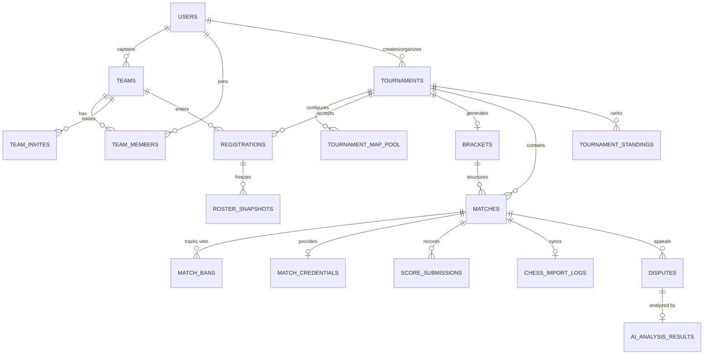

# Data Storage Schema Specification (PostgreSQL DDL) — Tournado

> **Status:** Accepted  
> **Engine:** PostgreSQL 16+ (Dockerized official image)  
> **Migration tool:** Flyway (`V1__initial_schema.sql`)  
> **Traceability:** ADR-0004, ADR-0005, ADR-0007, E1–E13 in `docs/analysis/requirements-digest.md`, US-01–US-36

---

## 1. Schema Design Principles & Conventions

As mandated by **ADR-0004**, the database is the **Single Source of Truth** for Tournado. Business invariants and data integrity are enforced directly at the storage level:

1. **Primary Keys:** Every table uses application-generated `UUID` primary keys (`id UUID PRIMARY KEY`). IDs are non-sequential, preventing enumeration attacks on public URLs (BR-15).
2. **Timestamps:** All time fields use `TIMESTAMPTZ` and are strictly stored in UTC (`Instant` in Java). Deadlines are compared directly on the server (NFR-07, ASM-15).
3. **Enumerations:** Represented as `VARCHAR(32)` or `TEXT` with strict SQL `CHECK` constraints, allowing clear SQL readability and zero-migration enum extensions.
4. **Optimistic Locking:** Aggregate roots that undergo concurrent state updates (`tournaments`, `matches`, `teams`) contain a `version BIGINT NOT NULL DEFAULT 0` column for `@Version` concurrency checks (NFR-05).
5. **Partial Indexes:** Used to enforce business rules under race conditions (e.g., ensuring a match cannot have more than one open dispute at a time).
6. **Snapshots:** When rosters lock (US-14), identifiers are snapshotted into `registration_roster_snapshots` to insulate tournaments from mid-event profile edits (ASM-09, NFR-11).
7. **File Storage:** Screenshot files reside on a mounted volume (`/data/uploads`); only relative file path, MIME type, and size are stored in the `disputes` table (ADR-0004).

---

## 2. Entity-Relationship Overview



---

## 3. Production DDL Script (`V1__initial_schema.sql`)

```sql
-- ============================================================================
-- Tournado MVP Database Schema (PostgreSQL 16+)
-- ============================================================================

CREATE EXTENSION IF NOT EXISTS "uuid-ossp";

-- ----------------------------------------------------------------------------
-- 1. USERS & PROFILES (E1)
-- ----------------------------------------------------------------------------
CREATE TABLE users (
    id UUID PRIMARY KEY DEFAULT uuid_generate_v4(),
    email VARCHAR(255) NULL UNIQUE,
    steam_id VARCHAR(64) NULL UNIQUE,
    display_name VARCHAR(100) NOT NULL,
    supercell_player_tag VARCHAR(32) NULL,
    chess_username VARCHAR(64) NULL,
    avatar_url TEXT NULL,
    created_at TIMESTAMPTZ NOT NULL DEFAULT CURRENT_TIMESTAMP,
    updated_at TIMESTAMPTZ NOT NULL DEFAULT CURRENT_TIMESTAMP,
    
    CONSTRAINT chk_users_at_least_one_auth CHECK (
        email IS NOT NULL OR steam_id IS NOT NULL
    )
);

CREATE INDEX idx_users_email ON users(email);
CREATE INDEX idx_users_steam_id ON users(steam_id);
CREATE INDEX idx_users_chess_username ON users(LOWER(chess_username));

-- ----------------------------------------------------------------------------
-- 2. EMAIL MAGIC LOGIN TOKENS (E1, ADR-0007)
-- ----------------------------------------------------------------------------
CREATE TABLE email_login_tokens (
    id UUID PRIMARY KEY DEFAULT uuid_generate_v4(),
    email VARCHAR(255) NOT NULL,
    token_hash VARCHAR(128) NOT NULL UNIQUE,
    expires_at TIMESTAMPTZ NOT NULL,
    used_at TIMESTAMPTZ NULL,
    created_at TIMESTAMPTZ NOT NULL DEFAULT CURRENT_TIMESTAMP
);

CREATE INDEX idx_email_tokens_lookup ON email_login_tokens(token_hash) WHERE used_at IS NULL;

-- ----------------------------------------------------------------------------
-- 3. TEAMS & ROSTERS (E2, E3)
-- ----------------------------------------------------------------------------
CREATE TABLE teams (
    id UUID PRIMARY KEY DEFAULT uuid_generate_v4(),
    name VARCHAR(100) NOT NULL,
    discipline VARCHAR(32) NOT NULL,
    captain_id UUID NOT NULL REFERENCES users(id) ON DELETE RESTRICT,
    created_at TIMESTAMPTZ NOT NULL DEFAULT CURRENT_TIMESTAMP,
    updated_at TIMESTAMPTZ NOT NULL DEFAULT CURRENT_TIMESTAMP,
    version BIGINT NOT NULL DEFAULT 0,
    
    CONSTRAINT chk_teams_discipline CHECK (discipline IN ('CS2', 'BRAWL_STARS', 'CHESS')),
    CONSTRAINT uq_teams_name_discipline UNIQUE (name, discipline)
);

CREATE INDEX idx_teams_captain ON teams(captain_id);
CREATE INDEX idx_teams_discipline ON teams(discipline);

CREATE TABLE team_members (
    id UUID PRIMARY KEY DEFAULT uuid_generate_v4(),
    team_id UUID NOT NULL REFERENCES teams(id) ON DELETE CASCADE,
    user_id UUID NOT NULL REFERENCES users(id) ON DELETE CASCADE,
    joined_at TIMESTAMPTZ NOT NULL DEFAULT CURRENT_TIMESTAMP,
    
    CONSTRAINT uq_team_members_team_user UNIQUE (team_id, user_id)
);

CREATE INDEX idx_team_members_user ON team_members(user_id);

CREATE TABLE team_invites (
    id UUID PRIMARY KEY DEFAULT uuid_generate_v4(),
    team_id UUID NOT NULL REFERENCES teams(id) ON DELETE CASCADE,
    token VARCHAR(64) NOT NULL UNIQUE,
    created_by UUID NOT NULL REFERENCES users(id) ON DELETE RESTRICT,
    is_active BOOLEAN NOT NULL DEFAULT TRUE,
    expires_at TIMESTAMPTZ NOT NULL,
    created_at TIMESTAMPTZ NOT NULL DEFAULT CURRENT_TIMESTAMP
);

CREATE INDEX idx_team_invites_token ON team_invites(token) WHERE is_active = TRUE;

-- ----------------------------------------------------------------------------
-- 4. TOURNAMENTS & MAP POOL (E4)
-- ----------------------------------------------------------------------------
CREATE TABLE tournaments (
    id UUID PRIMARY KEY DEFAULT uuid_generate_v4(),
    name VARCHAR(150) NOT NULL,
    description TEXT NULL,
    discipline VARCHAR(32) NOT NULL,
    format VARCHAR(32) NOT NULL DEFAULT 'SINGLE_ELIMINATION',
    slot_limit INTEGER NOT NULL,
    status VARCHAR(32) NOT NULL DEFAULT 'DRAFT',
    
    registration_deadline_at TIMESTAMPTZ NOT NULL,
    check_in_opens_at TIMESTAMPTZ NOT NULL,
    start_time_at TIMESTAMPTZ NOT NULL,
    
    cs2_server_connect TEXT NULL,
    created_by_user_id UUID NOT NULL REFERENCES users(id) ON DELETE RESTRICT,
    created_at TIMESTAMPTZ NOT NULL DEFAULT CURRENT_TIMESTAMP,
    updated_at TIMESTAMPTZ NOT NULL DEFAULT CURRENT_TIMESTAMP,
    version BIGINT NOT NULL DEFAULT 0,
    
    CONSTRAINT chk_tournaments_discipline CHECK (discipline IN ('CS2', 'BRAWL_STARS', 'CHESS')),
    CONSTRAINT chk_tournaments_format CHECK (format IN ('SINGLE_ELIMINATION')),
    CONSTRAINT chk_tournaments_slots CHECK (slot_limit IN (8, 16, 32)),
    CONSTRAINT chk_tournaments_status CHECK (
        status IN ('DRAFT', 'REGISTRATION_OPEN', 'CHECK_IN_ACTIVE', 'IN_PROGRESS', 'COMPLETED')
    ),
    CONSTRAINT chk_tournaments_schedule_order CHECK (
        registration_deadline_at < check_in_opens_at AND
        check_in_opens_at < start_time_at
    )
);

CREATE INDEX idx_tournaments_status ON tournaments(status);
CREATE INDEX idx_tournaments_discipline ON tournaments(discipline);

CREATE TABLE tournament_map_pool (
    id UUID PRIMARY KEY DEFAULT uuid_generate_v4(),
    tournament_id UUID NOT NULL REFERENCES tournaments(id) ON DELETE CASCADE,
    map_name VARCHAR(64) NOT NULL,
    sort_order INTEGER NOT NULL DEFAULT 0,
    
    CONSTRAINT uq_tournament_map UNIQUE (tournament_id, map_name)
);

-- ----------------------------------------------------------------------------
-- 5. REGISTRATIONS & ROSTER SNAPSHOTS (E5)
-- ----------------------------------------------------------------------------
CREATE TABLE registrations (
    id UUID PRIMARY KEY DEFAULT uuid_generate_v4(),
    tournament_id UUID NOT NULL REFERENCES tournaments(id) ON DELETE RESTRICT,
    team_id UUID NOT NULL REFERENCES teams(id) ON DELETE RESTRICT,
    status VARCHAR(32) NOT NULL DEFAULT 'REGISTERED',
    registered_at TIMESTAMPTZ NOT NULL DEFAULT CURRENT_TIMESTAMP,
    checked_in_at TIMESTAMPTZ NULL,
    excluded_at TIMESTAMPTZ NULL,
    exclusion_reason TEXT NULL,
    
    CONSTRAINT chk_registrations_status CHECK (
        status IN ('REGISTERED', 'CHECKED_IN', 'EXCLUDED')
    ),
    CONSTRAINT uq_registration_tournament_team UNIQUE (tournament_id, team_id)
);

CREATE INDEX idx_registrations_tournament_status ON registrations(tournament_id, status);

CREATE TABLE registration_roster_snapshots (
    id UUID PRIMARY KEY DEFAULT uuid_generate_v4(),
    registration_id UUID NOT NULL REFERENCES registrations(id) ON DELETE CASCADE,
    user_id UUID NOT NULL REFERENCES users(id) ON DELETE RESTRICT,
    display_name VARCHAR(100) NOT NULL,
    game_identifier VARCHAR(100) NOT NULL,
    is_captain BOOLEAN NOT NULL DEFAULT FALSE,
    snapshotted_at TIMESTAMPTZ NOT NULL DEFAULT CURRENT_TIMESTAMP,
    
    CONSTRAINT uq_snapshot_reg_user UNIQUE (registration_id, user_id)
);

CREATE INDEX idx_roster_snapshots_reg ON registration_roster_snapshots(registration_id);

-- ----------------------------------------------------------------------------
-- 6. BRACKETS & MATCHES (E6, E7, E8)
-- ----------------------------------------------------------------------------
CREATE TABLE brackets (
    id UUID PRIMARY KEY DEFAULT uuid_generate_v4(),
    tournament_id UUID NOT NULL UNIQUE REFERENCES tournaments(id) ON DELETE CASCADE,
    type VARCHAR(32) NOT NULL DEFAULT 'SINGLE_ELIMINATION',
    total_rounds INTEGER NOT NULL,
    generated_at TIMESTAMPTZ NOT NULL DEFAULT CURRENT_TIMESTAMP,
    
    CONSTRAINT chk_brackets_type CHECK (type IN ('SINGLE_ELIMINATION'))
);

CREATE TABLE matches (
    id UUID PRIMARY KEY DEFAULT uuid_generate_v4(),
    tournament_id UUID NOT NULL REFERENCES tournaments(id) ON DELETE CASCADE,
    bracket_id UUID NOT NULL REFERENCES brackets(id) ON DELETE CASCADE,
    round_number INTEGER NOT NULL,
    match_order INTEGER NOT NULL,
    
    team1_id UUID NULL REFERENCES teams(id) ON DELETE RESTRICT,
    team2_id UUID NULL REFERENCES teams(id) ON DELETE RESTRICT,
    winner_team_id UUID NULL REFERENCES teams(id) ON DELETE RESTRICT,
    
    status VARCHAR(32) NOT NULL DEFAULT 'PENDING',
    is_bye BOOLEAN NOT NULL DEFAULT FALSE,
    
    -- Real-time timestamps & server deadlines (ADR-0005)
    ready_deadline_at TIMESTAMPTZ NULL,
    ban_deadline_at TIMESTAMPTZ NULL,
    team1_ready BOOLEAN NOT NULL DEFAULT FALSE,
    team2_ready BOOLEAN NOT NULL DEFAULT FALSE,
    current_ban_turn_team_id UUID NULL REFERENCES teams(id) ON DELETE RESTRICT,
    decided_map VARCHAR(64) NULL,
    
    created_at TIMESTAMPTZ NOT NULL DEFAULT CURRENT_TIMESTAMP,
    updated_at TIMESTAMPTZ NOT NULL DEFAULT CURRENT_TIMESTAMP,
    version BIGINT NOT NULL DEFAULT 0,
    
    CONSTRAINT chk_matches_status CHECK (
        status IN ('PENDING', 'READY_CHECK', 'PICK_BAN', 'IN_PROGRESS', 'COMPLETED', 'DISPUTED')
    ),
    CONSTRAINT uq_matches_round_order UNIQUE (tournament_id, round_number, match_order)
);

CREATE INDEX idx_matches_tournament_round ON matches(tournament_id, round_number);
CREATE INDEX idx_matches_status ON matches(status);

CREATE TABLE match_bans (
    id UUID PRIMARY KEY DEFAULT uuid_generate_v4(),
    match_id UUID NOT NULL REFERENCES matches(id) ON DELETE CASCADE,
    team_id UUID NOT NULL REFERENCES teams(id) ON DELETE RESTRICT,
    map_name VARCHAR(64) NOT NULL,
    ban_order INTEGER NOT NULL,
    banned_at TIMESTAMPTZ NOT NULL DEFAULT CURRENT_TIMESTAMP,
    
    CONSTRAINT uq_match_map_banned UNIQUE (match_id, map_name),
    CONSTRAINT uq_match_ban_order UNIQUE (match_id, ban_order)
);

CREATE TABLE match_credentials (
    id UUID PRIMARY KEY DEFAULT uuid_generate_v4(),
    match_id UUID NOT NULL UNIQUE REFERENCES matches(id) ON DELETE CASCADE,
    cs2_connect_string TEXT NULL,
    brawl_stars_code VARCHAR(32) NULL,
    chess_game_url TEXT NULL,
    created_at TIMESTAMPTZ NOT NULL DEFAULT CURRENT_TIMESTAMP
);

-- ----------------------------------------------------------------------------
-- 7. SCORE SUBMISSIONS & CHESS INTEGRATION (E9, E10)
-- ----------------------------------------------------------------------------
CREATE TABLE score_submissions (
    id UUID PRIMARY KEY DEFAULT uuid_generate_v4(),
    match_id UUID NOT NULL REFERENCES matches(id) ON DELETE CASCADE,
    team_id UUID NOT NULL REFERENCES teams(id) ON DELETE RESTRICT,
    submitted_by_user_id UUID NOT NULL REFERENCES users(id) ON DELETE RESTRICT,
    team1_score INTEGER NOT NULL,
    team2_score INTEGER NOT NULL,
    submitted_at TIMESTAMPTZ NOT NULL DEFAULT CURRENT_TIMESTAMP,
    
    CONSTRAINT chk_scores_non_negative CHECK (team1_score >= 0 AND team2_score >= 0),
    CONSTRAINT uq_score_match_team UNIQUE (match_id, team_id)
);

CREATE INDEX idx_scores_match ON score_submissions(match_id);

CREATE TABLE chess_import_logs (
    id UUID PRIMARY KEY DEFAULT uuid_generate_v4(),
    match_id UUID NOT NULL UNIQUE REFERENCES matches(id) ON DELETE CASCADE,
    external_game_url TEXT NOT NULL,
    white_username VARCHAR(64) NOT NULL,
    black_username VARCHAR(64) NOT NULL,
    white_score NUMERIC(2,1) NOT NULL,
    black_score NUMERIC(2,1) NOT NULL,
    imported_at TIMESTAMPTZ NOT NULL DEFAULT CURRENT_TIMESTAMP
);

-- ----------------------------------------------------------------------------
-- 8. DISPUTES & AI ANALYSIS (E11, E12)
-- ----------------------------------------------------------------------------
CREATE TABLE disputes (
    id UUID PRIMARY KEY DEFAULT uuid_generate_v4(),
    match_id UUID NOT NULL REFERENCES matches(id) ON DELETE CASCADE,
    opened_by_team_id UUID NOT NULL REFERENCES teams(id) ON DELETE RESTRICT,
    opened_by_user_id UUID NOT NULL REFERENCES users(id) ON DELETE RESTRICT,
    status VARCHAR(32) NOT NULL DEFAULT 'OPEN',
    
    screenshot_file_path TEXT NOT NULL,
    screenshot_mime_type VARCHAR(64) NOT NULL,
    screenshot_file_size_bytes BIGINT NOT NULL,
    
    resolved_by_user_id UUID NULL REFERENCES users(id) ON DELETE RESTRICT,
    resolved_at TIMESTAMPTZ NULL,
    resolution_winner_team_id UUID NULL REFERENCES teams(id) ON DELETE RESTRICT,
    resolution_notes TEXT NULL,
    created_at TIMESTAMPTZ NOT NULL DEFAULT CURRENT_TIMESTAMP,
    
    CONSTRAINT chk_disputes_status CHECK (status IN ('OPEN', 'RESOLVED'))
);

-- Crucial invariant: exactly one active dispute allowed per match
CREATE UNIQUE INDEX uq_match_active_dispute ON disputes(match_id) WHERE status = 'OPEN';
CREATE INDEX idx_disputes_match ON disputes(match_id);

CREATE TABLE ai_analysis_results (
    id UUID PRIMARY KEY DEFAULT uuid_generate_v4(),
    dispute_id UUID NOT NULL UNIQUE REFERENCES disputes(id) ON DELETE CASCADE,
    status VARCHAR(32) NOT NULL DEFAULT 'SUCCESS',
    
    recognized_team1_score INTEGER NULL,
    recognized_team2_score INTEGER NULL,
    confidence NUMERIC(4,3) NULL,
    
    nicknames_detected JSONB NULL,
    nicknames_matched_all BOOLEAN NOT NULL DEFAULT FALSE,
    raw_response_payload JSONB NULL,
    analyzed_at TIMESTAMPTZ NOT NULL DEFAULT CURRENT_TIMESTAMP,
    
    CONSTRAINT chk_ai_status CHECK (status IN ('SUCCESS', 'UNRECOGNIZED', 'FAILED'))
);

-- ----------------------------------------------------------------------------
-- 9. STANDINGS & FINAL RESULTS (E13)
-- ----------------------------------------------------------------------------
CREATE TABLE tournament_standings (
    id UUID PRIMARY KEY DEFAULT uuid_generate_v4(),
    tournament_id UUID NOT NULL REFERENCES tournaments(id) ON DELETE CASCADE,
    team_id UUID NOT NULL REFERENCES teams(id) ON DELETE RESTRICT,
    rank_place INTEGER NOT NULL,
    created_at TIMESTAMPTZ NOT NULL DEFAULT CURRENT_TIMESTAMP,
    
    CONSTRAINT chk_standings_place CHECK (rank_place > 0),
    CONSTRAINT uq_tournament_team_place UNIQUE (tournament_id, rank_place),
    CONSTRAINT uq_tournament_team_entry UNIQUE (tournament_id, team_id)
);

CREATE INDEX idx_standings_tournament ON tournament_standings(tournament_id, rank_place);
```

---

## 4. Entity-to-Table Mapping & Constraints Summary

| Entity Code | Entity Name | Primary Table | Key Constraints & Invariants |
| :---: | :--- | :--- | :--- |
| **E1** | User / Profile | `users`, `email_login_tokens` | `email` unique; `steam_id` unique; at least one auth method required. |
| **E2** | Team | `teams`, `team_members` | `UNIQUE(name, discipline)`; creator is initial captain; size limit checked via business rule + membership count. |
| **E3** | Team Invite Link | `team_invites` | `token` unique; single active link per team; expiry index. |
| **E4** | Tournament | `tournaments`, `tournament_map_pool` | `slot_limit IN (8, 16, 32)`; schedule: `deadline < check_in < start`; status enum. |
| **E5** | Registration | `registrations`, `registration_roster_snapshots` | `UNIQUE(tournament_id, team_id)`; roster frozen at Roster Lock. |
| **E6** | Bracket | `brackets` | 1:1 with tournament; `type = 'SINGLE_ELIMINATION'`. |
| **E7** | Match | `matches` | `status` enum; `ready_deadline_at`, `ban_deadline_at` server timestamps. |
| **E8** | Match Room State | `matches`, `match_bans`, `match_credentials` | Turn-based veto tracking; `UNIQUE(match_id, map_name)`; 1:1 credentials. |
| **E9** | Score Submission | `score_submissions` | `UNIQUE(match_id, team_id)`; non-negative scores. |
| **E10** | Chess Result Import| `chess_import_logs` | 1:1 with match; stores external match URL and game scores. |
| **E11** | Dispute | `disputes` | **Partial Index:** `UNIQUE(match_id) WHERE status = 'OPEN'`; screenshot metadata. |
| **E12** | AI Analysis | `ai_analysis_results` | 1:1 with dispute; `status IN ('SUCCESS', 'UNRECOGNIZED', 'FAILED')`. |
| **E13** | Standings / Export | `tournament_standings` | `UNIQUE(tournament_id, rank_place)` ensures strict rankings. |
