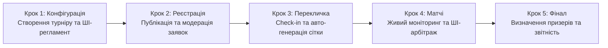

# Інженерна специфікація вимог — Tournado

## 1. Головний шлях користувача (User Journey)

### 1.1. Ключова персона продукту (Primary Persona)

* **Ім'я та вік:** Максим, 21 рік.
* **Роль:** Студентський організатор кіберспортивних змагань, ком'юніті-менеджер університетського ігрового клубу.
* **Контекст:** Має завдання провести відкритий студентський турнір вихідного дня (наприклад, по Counter-Strike 2 на 16 команд) у стислі терміни (до 5 годин) без затримок і скандалів.
* **Головні болі до Tournado:** Ручне ведення сіток в Excel, необхідність писати кожному капітану в Discord, нескінченні затримки через повільний вибір карт у текстових повідомленнях, неявка команд («мертві душі») та затяжні суперечки через сфальсифіковані результати.
* **Обґрунтування вибору персони:** Організатор є головним актором і координатором усієї екосистеми змагань. Без чіткого та зручного інструменту створення турніру та контролю розкладу команди не мають єдиного простору для чесної гри. Автоматизація роботи організатора автоматично створює прозорі та якісні умови для всіх учасників турніру.

---

### 1.2. Лінійний ланцюжок дій за основним успішним сценарієм (Happy Path)

Нижче наведено хронологічний шлях організатора від першого знайомства з платформою до отримання підсумкової звітності. Опис орієнтований на користувацькі дії та бізнес-результати без внутрішнього технічного жаргону.

#### Крок 1: Створення та конфігурація турніру
* **Дія організатора:** Максим авторизується на платформі через Steam або пошту, натискає «Створити турнір», обирає гру (Counter-Strike 2), турнірний формат (Single Elimination на 16 слотів) та вказує дату й час старту. Далі він вводить короткий опис формату у поле помічника (наприклад: *«Студентський кубок, матчі до однієї перемоги, фінал до двох, таймер явки 10 хвилин»*).
* **Реакція системи:** Платформа автоматично підтягує офіційний пул карт, налаштовує розмір команд (5v5), активує таймери для кімнати матчу (30 секунд на бан карти) та генерує структурований проєкт регламенту змагань. Максим переглядає згенерований текст, за потреби коригує правила овертаймів і зберігає налаштування.
* **Результат кроку:** Створено повністю налаштовану публічну подію з індивідуальними правилами, розкладом і готовою сторінкою для збору учасників.

#### Крок 2: Відкриття реєстрації та управління заявками
* **Дія організатора:** Максим копіює коротке запрошувальне посилання на турнір і публікує його в університетському Discord-сервері та Telegram-каналі.
* **Реакція системи:** Капітани команд переходять за посиланням і подають заявки. Система в режимі реального часу перевіряє, щоб кожен гравець у заявленому складі мав заповнений профіль та валідний ігровий ідентифікатор (Steam ID). У разі заповнення всіх 16 основних слотів наступні заявки автоматично спрямовуються до листа очікування.
* **Результат кроку:** Максим бачить прозорий список із 16 повністю укомплектованих команд, перевіряє назви на відповідність цензурі та в один клік фіксує ростери (Roster Lock), унеможливлюючи несанкціоновані заміни гравців під час турніру.

#### Крок 3: Етап переклички (Check-in) та автоматична генерація сітки
* **Дія організатора:** За 30 хвилин до старту Максим відкриває дашборд управління подією та спостерігає за процесом підтвердження явки команд.
* **Реакція системи:** Tournado надсилає сповіщення капітанам і запускає 30-хвилинне вікно Check-in. Дві команди, які не вийшли на зв'язок до закінчення таймера, автоматично відсіюються системою як «мертві душі», а на їхнє місце підтягуються дві перші активні команди з листа очікування. Рівно о запланованій годині система автоматично формує збалансовану турнірну сітку, розподіляє стартові пари та відкриває кімнати матчів першого раунду.
* **Результат кроку:** Турнірна сітка сформована виключно з реальних, присутніх учасників. Максим уникає ручного жеребкування та необхідності екстрено шукати заміну за 5 хвилин до гри.

#### Крок 4: Проведення турніру, моніторинг живих матчів та ШІ-арбітраж
* **Дія організатора:** Максим відкриває живий оглядовий дашборд турніру, на якому відображається статус кожної пари: хто перебуває на стадії підтвердження готовності, хто обирає карти, а хто вже грає.
* **Реакція системи:** Усі матчі першого туру відбуваються автоматично. Капітани входять у кімнату матчу, тиснуть «Готовий», по черзі викреслюють карти за таймером 30 секунд і отримують прямий рядок підключення до гри. Після закінчення гри обидва капітани вносять однаковий рахунок (13:9), і система самостійно пересуває переможця у наступний раунд сітки. 
* **ШІ-арбітраж у випадку суперечки:** В одному з матчів капітани вказали суперечливі результати. Система миттєво позначає матч як «Спірний» та виводить Максиму картку арбітражу: показує завантажений скріншот підсумкового табло гри та висновок ШІ-помічника (*«Розпізнано рахунок 13:10 на користь команди Alpha. Усі 10 нікнеймів збігаються з офіційним ростером. Впевненість 98%»*). Максим натискає кнопку «Затвердити вердикт ШІ», матч успішно закривається, а турнір продовжується без затримок.
* **Результат кроку:** Усі тури змагань проходять синхронно та за графіком. Максим не витрачає час на ручний перегляд чатів і вирішує єдину суперечку за 30 секунд.

#### Крок 5: Завершення турніру та експорт результатів
* **Дія організатора:** Після перемоги однієї з команд у фінальному поєдинку Максим підтверджує завершення турніру на панелі керування.
* **Реакція системи:** Платформа фіксує підсумковий розподіл призових місць (1-ше, 2-ге та 3-тє), автоматично оновлює турнірні досягнення у профілях команд-переможців та генерує готову візуальну картку з результатами для соцмереж.
* **Результат кроку:** Максим за один клік завантажує структурований звіт про результати турніру (у форматі PDF/CSV) для звітності перед керівництвом університету чи спонсорами. Турнір завершено точно за розкладом за 4,5 години замість звичних 8-ми, без скандалів і з позитивними відгуками від студентів.

---

## 2. Карта користувацьких історій (Story Map)

### Крок 1: Створення та налаштування турніру

**Епік 1.1: Базова конфігурація та вибір дисципліни**
- Вибір гри зі списку (CS2, Brawl Stars, Chess.com) з автоматичним застосуванням шаблонів кімнати матчу та розміру команд (5v5, 3v3, 1v1).
- Вибір алгоритму турнірної сітки (Single Elimination або швейцарська система) та встановлення ліміту слотів (8, 16, 32, 64 учасники).
- Налаштування пулу доступних карт (Map Pool) і формату серії ігор (Best of 1 для відбіркових раундів, Best of 3 для фіналу).
- Збереження конфігурації турніру як шаблону для запуску регулярних щотижневих змагань у два кліки.

**Епік 1.2: Розклад і контроль таймінгів**
- Встановлення дати й часу старту турніру, дедлайну реєстрації та часу відкриття обов'язкового підтвердження участі (Check-in).
- Налаштування жорстких таймерів для кімнати матчу: ліміт часу на вихід у готовність (наприклад, 10 хвилин до технічної поразки) та час на один крок бану карти (30 секунд).
- Автоматичний прогноз тривалості всього турніру на основі кількості команд і формату сітки, щоб організатор розумів, чи вкладається подія у відведені 4-5 годин.

**Епік 1.3: Генерація регламенту та оформлення сторінки**
- Автоматична генерація тексту правил і регламенту за коротким текстовим описом організатора на базі валідованого каркаса за допомогою ШІ-асистента.
- Ручне редагування згенерованого регламенту, уточнення правил овертаймів, тай-брейків та технічних пауз.
- Оформлення публічної сторінки турніру: завантаження банера, додавання логотипів спонсорів чи студради, опис призового фонду та прикріплення посилання на трансляцію.

### Крок 2: Відкриття реєстрації та управління заявками команд

**Епік 2.1: Публікація та збір учасників**
- Генерація прямого публічного посилання або короткого інвайт-коду на сторінку турніру для поширення в Discord та Telegram.
- Автоматична публікація анонсу з кнопкою реєстрації у прив'язаний Discord-сервер спільноти через вебхук.
- Додавання кастомних полів до форми реєстрації (наприклад, факультет, навчальна група або курс для внутрішньоуніверситетських змагань).

**Епік 2.2: Модерація заявок та валідація ростерів**
- Перегляд списку зареєстрованих команд у реальному часі з індикацією заповненості ростерів (капітан, основний склад, запасні гравці).
- Автоматична перевірка наявності прив'язаних ігрових акаунтів у всіх заявлених учасників (Steam ID для CS2, Player Tag для Brawl Stars, профіль Chess.com) ще на етапі реєстрації.
- Ручне схвалення або відхилення заявок, а також примусове видалення команд із порушеннями правил чи некоректними назвами до початку ігор.
- Автоматична фіксація складів команд (Roster Lock) перед стартом турніру, щоб унеможливити додавання незареєстрованих сильних гравців під час матчів.

**Епік 2.3: Лист очікування та резервні слоти**
- Автоматичне формування списку очікування (Waitlist) для команд, які подали заявку після заповнення всіх основних слотів.
- Ручне додавання команди організатором або заміна команди, що знялася зі змагань до старту сітки.

### Крок 3: Етап Check-in та автоматична генерація сітки

**Епік 3.1: Відсіювання неактивних команд ("мертвих душ")**
- Автоматичне відкриття вікна Check-in за 30 хвилин до старту турніру з таймером зворотного відліку для всіх зареєстрованих капітанів і соло-гравців.
- Масова розсилка сповіщень учасникам про старт переклички та необхідність підтвердити готовність грати.
- Автоматичне виключення зі списку учасників тих команд, які не натиснули кнопку Check-in до завершення таймера, щоб уникнути порожніх слотів і зриву розкладу.
- Автоматичне підтягування підтверджених команд із листа очікування на місце відсіяних учасників.
- Можливість для організатора вручну поставити відмітку Check-in за команду, якщо капітан попередив про затримку особисто.

**Епік 3.2: Посів (Seeding) та побудова сітки**
- Автоматична генерація турнірної сітки виключно з присутніх команд одразу після закриття вікна Check-in.
- Вибір методу посіву (Seeding): випадкове жеребкування або розведення команд за рейтингом, щоб найсильніші учасники не зустрілися в першому раунді.
- Коректний автоматичний розподіл технічних проходів (Bye-раундів), якщо після відсіювання неактивних заявок кількість команд не дорівнює степеню двійки.
- Попередній перегляд згенерованої сітки з можливістю вручну поміняти команди місцями (Drag-and-Drop) перед офіційним стартом першого туру.

### Крок 4: Проведення турніру (моніторинг живих матчів та вирішення суперечок)

**Епік 4.1: Моніторинг прогресу та автоматизація Match Room**
- Перегляд живого дашборду організатора з актуальними статусами всіх матчів: очікування готовності (Ready Check), стадія бану карт (Pick/Ban), матч триває, очікування рахунку або спір.
- Автоматичне присудження технічної поразки команді або гравцю, який не підтвердив готовність у кімнаті матчу протягом 10 хвилин відведеного часу, без залучення організатора.
- Автоматичне закриття матчу і миттєве просування переможця у наступний раунд сітки, якщо обидва капітани ввели однаковий рахунок або результат надійшов через API Chess.com.
- Візуальне підсвічування затягнутих матчів, які перевищують середній ліміт часу і гальмують запуск наступного туру.

**Епік 4.2: Арбітраж і вирішення суперечок (Disputes) за допомогою ШІ**
- Отримання миттєвого сповіщення у панелі організатора, коли капітани ввели різні рахунки за матч або відкрили спір.
- Перегляд у картці спору завантажених скріншотів табло гри разом зі структурованою підказкою від Vision ШІ (розпізнаний рахунок матчу та відсоток впевненості моделі).
- Автоматична звірка нікнеймів гравців на завантаженому скріншоті із зафіксованим ростером команди в базі даних для виявлення підставних гравців ("рингерів").
- Закриття спірного матчу організатором в один клік на основі рекомендації ШІ або через ручне встановлення фінального рахунку.

**Епік 4.3: Ручне управління сіткою та комунікація**
- Підключення організатора до внутрішнього чату конкретної кімнати матчу для оперативного вирішення питань із капітанами.
- Інструменти ручного втручання (Admin Override): примусовий перезапуск стадії Pick/Ban, заміна посилання на лобі або відкат помилково закритого матчу з перерахунком гілки сітки.
- Відправка глобального оголошення (Broadcast) на екрани всіх активних учасників турніру (наприклад, повідомлення про технічну паузу або зміну розкладу).

### Крок 5: Завершення турніру та експорт результатів

**Епік 5.1: Фіналізація змагань та підрахунок рейтингів**
- Автоматичне переведення турніру в статус "Завершено" після закриття фінального матчу з формуванням підсумкового розподілу призових місць.
- Автоматичний розрахунок додаткових коефіцієнтів (Бухгольц, Бергер) для точного визначення переможців у турнірах за швейцарською системою.
- Автоматичне оновлення статистики в публічних профілях команд і гравців (історія матчів, відсоток перемог, здобуті трофеї).

**Епік 5.2: Візуалізація підсумків і звітність для спонсорів**
- Генерація готової брендованої картинки-інфографіки з призерами та фінальною сіткою в один клік для публікації у соцмережах студради чи ком'юніті.
- Експорт підсумкової таблиці результатів, сітки та списку учасників у форматах CSV/PDF для офіційної звітності перед керівництвом університету, профкомом або спонсорами.
- Формування внутрішньої аналітики для організатора за підсумками події: реальна тривалість турніру, відсоток неявок на етапі Check-in та кількість вирішених диспутів.

---

## 3. Межі скоупу (Scope)

### 3.1. Принцип відсікання

MVP - це **тонкий наскрізний зріз** через усі 5 кроків шляху: Максим має пройти від створення турніру до підсумкової таблиці, використовуючи лише історії з In Scope. Кожну історію з карти (розділ 2) ми оцінили за MoSCoW:

- **Must** - без неї шлях обривається або не закривається головний біль персони («мертві душі», ручна сітка, ручні рахунки, суперечки, підставні гравці). Лише Must входять у **In Scope (MVP)**.
- **Should / Could / Won't** - корисні, але не критичні історії. Вони йдуть в **Out of Scope (Post-MVP)** із поясненням, чому саме.

Якщо в історії поєднано просту базову частину і дорогу розширену, ми розділили її: базова частина йде в MVP, розширена - у Post-MVP (позначено як `а` / `б`).

Нумерація: `Крок.Епік.Номер` - відповідає порядку історій у розділі 2.

### 3.2. Карта історій з лінією відсікання

#### Крок 1: Створення та налаштування турніру

| № | Історія | MoSCoW | Рішення | Обґрунтування |
| :--- | :--- | :---: | :---: | :--- |
| 1.1.1 | Вибір гри (CS2, Brawl Stars, Chess.com) з автоматичним шаблоном матчу, розміром команд і стандартним пулом карт | Must | ✅ MVP | Без вибору дисципліни турнір неможливо створити; стандартний пул карт підставляється автоматично |
| 1.1.2а | Формат Single Elimination і ліміт слотів (8 / 16 / 32) | Must | ✅ MVP | Найпростіший формат, достатній для повного шляху |
| 1.1.2б | Швейцарська система | Should | ⏳ Post-MVP | Окремий складний алгоритм пар і тай-брейків; Single Elimination закриває сценарій ключової персони |
| 1.1.3 | Редагування пулу карт і формат Best of 3 для фіналу | Could | ⏳ Post-MVP | Серія з кількох карт ускладнює кімнату матчу; у MVP усі матчі Best of 1 зі стандартним пулом |
| 1.1.4 | Збереження турніру як шаблону | Could | ⏳ Post-MVP | Цінність лише для регулярних турнірів; обхід - створити новий за 2 хвилини |
| 1.2.1 | Дата й час старту, дедлайн реєстрації, час відкриття Check-in | Must | ✅ MVP | Без розкладу неможливий автоматичний Check-in - головний засіб проти «мертвих душ» |
| 1.2.2 | Налаштування значень таймерів кімнати матчу | Could | ⏳ Post-MVP | У MVP таймери працюють із фіксованими значеннями (10 хв на готовність, 30 с на бан); змінювати їх не обов'язково |
| 1.2.3 | Прогноз тривалості турніру | Could | ⏳ Post-MVP | Не на критичному шляху; організатор оцінює тривалість сам |
| 1.3.1 | ШІ-генерація регламенту за описом | Should | ⏳ Post-MVP | Ризик галюцинацій у критичних правилах (висновок практики 2); ресурс AI-напряму в MVP зосереджено на суперечках |
| 1.3.2 | Ручне редагування регламенту | Could | ⏳ Post-MVP | Залежить від 1.3.1; у MVP правила вписуються в поле «Опис турніру» під час створення (1.1.1) |
| 1.3.3 | Оформлення сторінки: банер, спонсори, призовий фонд, трансляція | Could | ⏳ Post-MVP | Косметика, не закриває болю; базова сторінка з назвою, грою, датою, описом і учасниками входить у 2.1.1 |

#### Крок 2: Відкриття реєстрації та управління заявками

| № | Історія | MoSCoW | Рішення | Обґрунтування |
| :--- | :--- | :---: | :---: | :--- |
| 2.1.1 | Публічне посилання на сторінку турніру | Must | ✅ MVP | Єдиний спосіб зібрати учасників; поширюється вручну в Discord / Telegram |
| 2.1.2 | Автоанонс у Discord через вебхук | Could | ⏳ Post-MVP | Зовнішня інтеграція; обхід - скопіювати посилання з 2.1.1 |
| 2.1.3 | Кастомні поля форми реєстрації | Won't | ⏳ Post-MVP | Потрібні лише внутрішньоуніверситетським турнірам; додає конструктор форм |
| 2.2.1 | Список зареєстрованих команд із заповненістю ростерів | Must | ✅ MVP | Організатор має бачити, хто реально бере участь |
| 2.2.2а | Перевірка, що в кожного гравця вказано ігровий ідентифікатор потрібної гри (Steam ID / Player Tag / нік Chess.com) | Must | ✅ MVP | Без ідентифікаторів не працює ні звірка нікнеймів (4.2.3), ні автоімпорт шахових результатів (4.1.3б) |
| 2.2.2б | Перевірка існування акаунтів через API ігор | Should | ⏳ Post-MVP | API Brawl Stars вимагає ключа з прив'язкою до IP; перевірку замінює звірка нікнеймів у суперечках |
| 2.2.3а | Видалення команди організатором до старту | Must | ✅ MVP | Мінімальна модерація (порушення, образливі назви) |
| 2.2.3б | Режим ручного схвалення кожної заявки | Could | ⏳ Post-MVP | Для відкритого турніру достатньо видалення після реєстрації |
| 2.2.4 | Фіксація складів (Roster Lock) перед стартом | Must | ✅ MVP | Закриває біль підставних гравців; база для звірки нікнеймів |
| 2.3.1 | Лист очікування | Should | ⏳ Post-MVP | Без нього сітка все одно будується з присутніх команд, а порожні місця закриваються технічними проходами (3.2.3) |
| 2.3.2 | Ручне додавання або заміна команди | Could | ⏳ Post-MVP | Рідкісний випадок; обхід - капітан реєструє команду сам до дедлайну |

#### Крок 3: Check-in та автоматична генерація сітки

| № | Історія | MoSCoW | Рішення | Обґрунтування |
| :--- | :--- | :---: | :---: | :--- |
| 3.1.1 | Автоматичне відкриття вікна Check-in із таймером | Must | ✅ MVP | Ядро боротьби з «мертвими душами» |
| 3.1.2 | Масова розсилка сповіщень учасникам | Should | ⏳ Post-MVP | Потребує інтеграції з поштою / Telegram / Discord; у MVP статус Check-in видно на сторінці турніру |
| 3.1.3 | Автоматичне виключення команд без Check-in | Must | ✅ MVP | Головний біль персони - сітка не ламається через неявки |
| 3.1.4 | Підтягування команд із листа очікування | Should | ⏳ Post-MVP | Залежить від відкладеної 2.3.1 |
| 3.1.5 | Ручна відмітка Check-in організатором | Could | ⏳ Post-MVP | Обхід - капітан підтверджує участь сам із телефона |
| 3.2.1 | Автоматична генерація сітки з присутніх команд | Must | ✅ MVP | Головний біль - ручне креслення сітки в Excel |
| 3.2.2а | Випадкове жеребкування (посів) | Must | ✅ MVP | Найпростіший чесний посів; виконується в межах 3.2.1 |
| 3.2.2б | Посів за рейтингом | Could | ⏳ Post-MVP | На старті платформи ще немає рейтингу команд |
| 3.2.3 | Технічні проходи (Bye), якщо кількість команд не є степенем двійки | Must | ✅ MVP | Після відсіювання неявок це майже гарантовано станеться; без цього сітка не будується |
| 3.2.4 | Попередній перегляд сітки з перетягуванням команд | Could | ⏳ Post-MVP | Ручне втручання суперечить ідеї автоматизації; випадкового жеребкування достатньо |

#### Крок 4: Проведення турніру та вирішення суперечок

| № | Історія | MoSCoW | Рішення | Обґрунтування |
| :--- | :--- | :---: | :---: | :--- |
| 4.1.1 | Живий дашборд організатора зі статусами всіх матчів | Must | ✅ MVP | Головний робочий екран Максима під час турніру |
| 4.1.2 | Автоматична технічна поразка за неготовність протягом 10 хвилин | Must | ✅ MVP | Закриває затягування матчів без участі організатора |
| 4.1.3а | Автозакриття матчу і просування переможця, якщо обидва капітани ввели однаковий рахунок (CS2, Brawl Stars) | Must | ✅ MVP | Головний біль - ручне перенесення рахунків |
| 4.1.3б | Автоматичне підтягування результату партії з відкритого архіву Chess.com | Must | ✅ MVP | Відкритий API лише для читання, низький ризик; закриває сценарій шахів без ручного введення |
| 4.1.4 | Підсвічування затягнутих матчів | Could | ⏳ Post-MVP | Таймер готовності (4.1.2) вже закриває основну причину затримок |
| 4.2.1 | Сповіщення організатора про спірний матч | Must | ✅ MVP | Спірний матч не має загубитися; у MVP це статус «Спір» і лічильник на дашборді 4.1.1 |
| 4.2.2 | Картка спору зі скріншотом і підказкою ШІ (розпізнаний рахунок і впевненість) | Must | ✅ MVP | Ключова ШІ-функція продукту; ШІ лише підказує, рішення за людиною (висновок практики 2) |
| 4.2.3 | Звірка нікнеймів зі скріншота з ростером | Must | ✅ MVP | Закриває біль підставних гравців; виконується тим самим зверненням до ШІ, що й 4.2.2 |
| 4.2.4 | Закриття спору в один клік (вердикт ШІ або ручний рахунок) | Must | ✅ MVP | Без цього спірний матч блокує сітку |
| 4.3.1 | Чат організатора в кімнаті матчу | Should | ⏳ Post-MVP | Обхід - Discord, яким учасники вже користуються |
| 4.3.2 | Ручне втручання: перезапуск Pick/Ban, заміна лобі, відкат матчу з перерахунком гілки | Should | ⏳ Post-MVP | Відкат із перерахунком сітки - складна логіка; у MVP помилковий рахунок виправляється через спір (4.2.4) до просування |
| 4.3.3 | Глобальне оголошення для всіх учасників | Could | ⏳ Post-MVP | Обхід - оголошення в Discord-сервері турніру |

#### Крок 5: Завершення турніру та експорт результатів

| № | Історія | MoSCoW | Рішення | Обґрунтування |
| :--- | :--- | :---: | :---: | :--- |
| 5.1.1 | Статус «Завершено» і розподіл призових місць після фіналу | Must | ✅ MVP | Логічне завершення шляху |
| 5.1.2 | Коефіцієнти Бухгольца й Бергера | Should | ⏳ Post-MVP | Потрібні лише для швейцарської системи (1.1.2б), яку відкладено |
| 5.1.3 | Оновлення статистики в профілях команд і гравців | Could | ⏳ Post-MVP | Цінність проявляється лише після серії турнірів |
| 5.2.1 | Інфографіка з призерами для соцмереж | Could | ⏳ Post-MVP | Обхід - скріншот фінальної сітки |
| 5.2.2а | Експорт результатів і учасників у CSV | Must | ✅ MVP | Мета персони - звіт для профкому чи спонсорів; CSV відкривається в Excel без додаткових бібліотек |
| 5.2.2б | Експорт у PDF | Could | ⏳ Post-MVP | Обхід - зберегти CSV як PDF з Excel |
| 5.2.3 | Аналітика організатора (тривалість, відсоток неявок, кількість суперечок) | Could | ⏳ Post-MVP | Не на критичному шляху першого турніру |

### 3.3. Опорні історії учасників (In Scope)

Карта в розділі 2 описує лише дії організатора. Щоб його шлях реально пройшов, у MVP обов'язково потрібні мінімальні дії капітанів і гравців:

| № | Хто | Історія | Чому без неї шлях обривається |
| :--- | :--- | :--- | :--- |
| У.1 | Будь-який користувач | Вхід на платформу через Steam або пошту | Без акаунта не можна ні створити турнір, ні зареєструватися |
| У.2 | Капітан | Створення команди та запрошення тімейтів за посиланням | Організатору нема кого приймати на турнір (крок 2) |
| У.3 | Капітан / соло-гравець | Реєстрація команди або себе на турнір за посиланням | Без заявок порожній крок 2 |
| У.4 | Капітан / соло-гравець | Підтвердження участі (Check-in) | Без нього всі команди будуть виключені (3.1.3) |
| У.5 | Учасник | Перегляд турнірної сітки | Учасники мають знати свого суперника і час матчу |
| У.6 | Капітан | Підтвердження готовності (Ready Check) у кімнаті матчу | На цьому базується автоматична технічна поразка (4.1.2) |
| У.7 | Капітан | Почерговий бан карт із таймером (CS2, Brawl Stars) | Замінює хаотичний вибір карт у чаті - ключова відмінність від Excel |
| У.8 | Капітан / гравець | Отримання даних для входу в гру: рядок підключення до сервера CS2 (вказує організатор), код дружньої кімнати Brawl Stars (вводить капітан), посилання на виклик Chess.com | Без цього матч фізично не почнеться |
| У.9 | Капітан | Введення рахунку після матчу (CS2, Brawl Stars) | Джерело даних для автозакриття (4.1.3а) і спорів (4.2.1) |
| У.10 | Капітан | Завантаження скріншота табло при суперечці | Вхідні дані для ШІ-підказки (4.2.2, 4.2.3) |

### 3.4. Підсумок скоупу

| | Кількість |
| :--- | :---: |
| Історій організатора в MVP | 23 |
| Опорних історій учасників у MVP | 10 |
| **Разом In Scope (MVP)** | **33** |
| Відкладено в Out of Scope (Post-MVP) | 28 |

**Розподіл MVP за ролями команди** (перевірка, що жодна роль не перевантажена):

| Роль | Історії MVP |
| :--- | :--- |
| Core Platform & Auth (Артем) | У.1, У.2, У.3, 2.2.2а, 2.2.3а, 2.2.4, 5.2.2а |
| Tournament Engine (Євгеній) | 1.1.2а, 1.2.1, 3.1.1, 3.1.3, 3.2.1, 3.2.2а, 3.2.3, 4.1.3а (просування), 5.1.1 |
| Game Integrations & Match Flow (Денис) | 1.1.1, У.4, У.6, У.7, У.8, У.9, 4.1.2, 4.1.3б |
| AI & Automation (Іван) | У.10, 4.2.2, 4.2.3, 4.2.4 (дані для вердикту) |
| Frontend (Андрій) | 2.1.1, 2.2.1, У.5, 4.1.1, 4.2.1, екрани кімнати матчу та картки спору |

Історії Tournament Engine невеликі й тісно пов'язані (сітка Single Elimination), а частка AI-напряму менша за кількістю, але найризиковіша технічно (якість розпізнавання скріншотів, підбір промптів для трьох різних табло).

### 3.5. Демо-сценарій MVP і відмінності від повного Happy Path

**Що покажемо наживо:** Максим входить через Steam, створює турнір CS2 на 8 слотів і ділиться посиланням. Капітани реєструють команди, одна з них не проходить Check-in і автоматично вибуває. Система будує сітку з технічним проходом. У кімнатах матчів капітани тиснуть «Готовий», банять карти й отримують рядок підключення. Один матч закривається автоматично за однаковим рахунком, в іншому виникає спір: Максим бачить скріншот, підказку ШІ з рахунком і перевіркою нікнеймів і закриває спір в один клік. Після фіналу турнір отримує статус «Завершено», а Максим вивантажує CSV. Окремо показуємо шаховий матч, результат якого підтягується з Chess.com без участі капітанів.

**Що з повного Happy Path (розділ 1) свідомо не входить у MVP:**
- ШІ-генерація регламенту (крок 1) - замінено полем «Опис турніру».
- Лист очікування й підтягування резервних команд (кроки 2-3) - замінено технічними проходами в сітці.
- Сповіщення капітанам про Check-in (крок 3) - статус видно на сторінці турніру.
- Інфографіка для соцмереж, PDF-звіт і оновлення профілів (крок 5) - замінено експортом у CSV.

---

## 4. Специфікація історій у роботі (User Stories)

У цьому розділі всі 33 вихідні елементи з In Scope (MVP) перетворено на фінальні інженерні User Stories. Ми провели рефайнінг кожної історії:
1. Перевірили формулювання за обов'язковим тричастинним шаблоном: **«Як [хто], я хочу [що], щоб [цінність/навіщо]»**.
2. Прибрали будь-який технічний сленг розробників (усі історії описані виключно мовою дій користувачів платформи).
3. Провели декомпозицію: розбили складні та подвійні дії на окремі атомарні історії, де одна історія відповідає за одну конкретну операцію.

### 4.1. Аналіз атомарності та декомпозиція змішаних історій

Під час рефайнінгу було виявлено 3 драфтові пункти з розділу 3, де змішувалися дві різні дії або конфігурації. Ми свідомо розділили їх на незалежні історії, щоб розробники могли кодити і тестувати їх окремо:

| Драфтовий пункт у Scope | Що було змішано | Як декомпозовано на атомарні історії | Чому це важливо |
| :--- | :--- | :--- | :--- |
| **1.1.1** (Вибір гри, шаблон матчу, пул карт) | В одній історії змішувався вибір формату дисципліни (5v5/3v3/1v1) та налаштування маппулу карт | Розбито на **US-07** (вибір гри та автоматичний формат команд) і **US-08** (автоматична підстановка стандартного списку карт) | Вибір дисципліни задає правила лобі, а пул карт використовується пізніше в інтерфейсі банів; це різні компоненти системи |
| **У.2** (Створення команди та запрошення тімейтів) | Одночасно описувалося збереження профілю команди в базі та генерація унікального інвайт-лінка | Розбито на **US-03** (створення команди капітаном) і **US-04** (генерація та поширення інвайт-посилання) | Створення команди - це збереження сутності, а запрошення за лінком - це окремий флоу шерингу та приєднання гравців |
| **У.8** (Отримання коннекту CS2, коду Brawl Stars, лінка Chess.com) | В одну історію злили три абсолютно різні типи реквізитів для трьох різних ігор | Розбито на **US-25** (рядок `connect IP` для сервера CS2) та **US-26** (код дружньої кімнати Brawl Stars або посилання на партію Chess.com) | CS2 вимагає підключення до виділеного сервера через консоль/клієнт, тоді як Brawl Stars і Chess.com працюють через коди лобі та веб-лінки |

Після декомпозиції загальний пул MVP-історій склав **36 атомарних User Stories**, згрупованих за 8 функціональними епіками.

---

### 4.2. Перелік декомпозованих User Stories для MVP

#### Епік 1: Автентифікація та профілі користувачів

* **US-01 (Вхід через сторонні сервіси):**  
  *Як відвідувач платформи, я хочу увійти в систему через акаунт Steam або електронну пошту, щоб отримати доступ до створення турнірів та участі в змаганнях.*  
  *(Покриває пункт Scope: У.1 | Відповідальний: Артем, Core Platform & Auth)*

* **US-02 (Прив'язка ігрових ідентифікаторів у профілі):**  
  *Як гравець, я хочу вказати свій Steam ID, Supercell Player Tag або нікнейм на Chess.com у налаштуваннях профілю, щоб система могла автоматично верифікувати мене в заявках команд.*  
  *(Покриває пункт Scope: 2.2.2а | Відповідальний: Артем, Core Platform & Auth)*

---

#### Епік 2: Управління командами та ростерами

* **US-03 (Створення команди):**  
  *Як капітан, я хочу створити нову команду із зазначенням назви та дисципліни, щоб представляти свій склад на турнірах платформи.*  
  *(Покриває пункт Scope: У.2а | Відповідальний: Артем, Core Platform & Auth)*

* **US-04 (Генерація інвайт-посилання до ростеру):**  
  *Як капітан, я хочу згенерувати унікальне посилання-запрошення для своєї команди, щоб швидко додати своїх тімейтів до основного складу без ручного пошуку їхніх акаунтів.*  
  *(Покриває пункт Scope: У.2б | Відповідальний: Артем, Core Platform & Auth)*

* **US-05 (Приєднання гравця до команди за посиланням):**  
  *Як гравець, я хочу перейти за запрошувальним посиланням від капітана та підтвердити вступ до ростеру, щоб офіційно брати участь у турнірах разом зі своєю командою.*  
  *(Покриває пункт Scope: У.2в | Відповідальний: Артем, Core Platform & Auth)*

* **US-06 (Перевірка повноти складу перед реєстрацією):**  
  *Як капітан, я хочу бачити наочний індикатор заповненості ростеру (наприклад, 5 із 5 для CS2), щоб переконатися, що команда зібрана і готова подавати заявку на турнір.*  
  *(Покриває пункт Scope: 2.2.1 | Відповідальний: Артем, Core Platform & Auth)*

---

#### Епік 3: Створення та налаштування турніру (Крок 1)

* **US-07 (Вибір дисципліни та формату команд):**  
  *Як організатор, я хочу вибрати гру (CS2, Brawl Stars або Chess.com) під час створення турніру, щоб платформа автоматично застосувала правильний розмір команд (5v5, 3v3 або 1v1).*  
  *(Покриває пункт Scope: 1.1.1а | Відповідальний: Денис, Game Integrations & Match Flow)*

* **US-08 (Автоматична підстановка пулу карт):**  
  *Як організатор, я хочу, щоб система автоматично підтягнула офіційний пул карт для обраної дисципліни, щоб мені не доводилося вводити назви карт вручну під час кожного створення події.*  
  *(Покриває пункт Scope: 1.1.1б | Відповідальний: Денис, Game Integrations & Match Flow)*

* **US-09 (Вибір формату сітки та ліміту слотів):**  
  *Як організатор, я хочу обрати формат Single Elimination та встановити ліміт слотів (8, 16 або 32 команди), щоб зафіксувати зрозумілу турнірну структуру під відведений час заходу.*  
  *(Покриває пункт Scope: 1.1.2а | Відповідальний: Євгеній, Tournament Engine)*

* **US-10 (Встановлення часового графіка турніру):**  
  *Як організатор, я хочу вказати дату і час початку змагань, дедлайн прийому заявок і час відкриття вікна Check-in, щоб автоматизувати запуск передтурнірних процесів.*  
  *(Покриває пункт Scope: 1.2.1 | Відповідальний: Євгеній, Tournament Engine)*

* **US-11 (Генерація публічного посилання на сторінку турніру):**  
  *Як організатор, я хочу отримати пряме публічне посилання на створену подію, щоб поділитися ним у студентських Discord-серверах та Telegram-каналах для збору учасників.*  
  *(Покриває пункт Scope: 2.1.1 | Відповідальний: Андрій, Frontend)*

---

#### Епік 4: Реєстрація команд та модерація заявок (Крок 2)

* **US-12 (Подача заявки команди на турнір):**  
  *Як капітан або соло-гравець, я хочу зареєструвати свою команду на турнір зі сторінки події, щоб забронювати слот в основній сітці змагань.*  
  *(Покриває пункт Scope: У.3 | Відповідальний: Артем, Core Platform & Auth)*

* **US-13 (Модерація та видалення команди до старту):**  
  *Як організатор, я хочу мати можливість вручну видалити команду зі списку зареєстрованих до початку ігор, щоб відсіяти заявки з образливими назвами або порушників регламенту.*  
  *(Покриває пункт Scope: 2.2.3а | Відповідальний: Артем, Core Platform & Auth)*

* **US-14 (Блокування складів Roster Lock):**  
  *Як організатор, я хочу, щоб система автоматично заблокувала можливість змінювати ростери команд після дедлайну реєстрації, щоб унеможливити заміну гравців на підставних під час матчів.*  
  *(Покриває пункт Scope: 2.2.4 | Відповідальний: Артем, Core Platform & Auth)*

---

#### Епік 5: Перекличка (Check-in) та генерація сітки (Крок 3)

* **US-15 (Автоматичний старт вікна Check-in):**  
  *Як організатор, я хочу, щоб система автоматично відкрила вікно переклички за 30 хвилин до турніру, щоб учасники могли підтвердити свою реальну присутність за комп'ютерами.*  
  *(Покриває пункт Scope: 3.1.1 | Відповідальний: Євгеній, Tournament Engine)*

* **US-16 (Підтвердження участі капітаном):**  
  *Як капітан команди, я хочу натиснути кнопку «Check-in» на сторінці турніру у відведений час, щоб підтвердити явку своєї команди і гарантувати потрапляння в сітку.*  
  *(Покриває пункт Scope: У.4 | Відповідальний: Денис, Game Integrations & Match Flow)*

* **US-17 (Автоматичне відсіювання неактивних команд):**  
  *Як організатор, я хочу, щоб команди, які не натиснули Check-in до завершення таймера, автоматично виключалися з турніру, щоб позбутися «мертвих душ» і не створювати порожніх матчів.*  
  *(Покриває пункт Scope: 3.1.3 | Відповідальний: Євгеній, Tournament Engine)*

* **US-18 (Автоматична побудова сітки Single Elimination):**  
  *Як організатор, я хочу, щоб сітка Single Elimination генерувалася автоматично рівно в час старту змагань, щоб не витрачати час на ручне креслення пар у таблицях.*  
  *(Покриває пункт Scope: 3.2.1 | Відповідальний: Євгеній, Tournament Engine)*

* **US-19 (Випадкове жеребкування пар першого туру):**  
  *Як організатор, я хочу, щоб підтверджені команди розподілялися по сітці методом сліпого жеребкування, щоб забезпечити чесний та неупереджений старт турніру.*  
  *(Покриває пункт Scope: 3.2.2а | Відповідальний: Євгеній, Tournament Engine)*

* **US-20 (Призначення технічних проходів Bye):**  
  *Як організатор, я хочу, щоб система автоматично призначала технічні проходи (Bye) у першому раунді, якщо кількість команд не кратна степеню двійки, щоб зберегти правильну геометрію сітки.*  
  *(Покриває пункт Scope: 3.2.3 | Відповідальний: Євгеній, Tournament Engine)*

* **US-21 (Публічний перегляд турнірної сітки):**  
  *Як гравець або глядач, я хочу переглядати інтерактивну сітку турніру з актуальними статусами пар, щоб знати свого наступного суперника та час матчу.*  
  *(Покриває пункт Scope: У.5 | Відповідальний: Андрій, Frontend)*

---

#### Епік 6: Кімната матчу (Match Room) та пре-матч (Крок 4)

* **US-22 (Спільний простір Match Room для пари):**  
  *Як капітан, я хочу зайти в індивідуальну веб-кімнату матчу за посиланням із сітки, щоб координувати гру з капітаном суперників у єдиному інтерфейсі.*  
  *(Покриває пункт Scope: 4.1.1 | Відповідальний: Денис, Game Integrations & Match Flow)*

* **US-23 (Підтвердження готовності Ready Check):**  
  *Як капітан, я хочу натиснути кнопку «Готовий» у кімнаті матчу, щоб зафіксувати присутність команди на сервері та розпочати пре-матч фазу.*  
  *(Покриває пункт Scope: У.6 | Відповідальний: Денис, Game Integrations & Match Flow)*

* **US-24 (Автоматична технічна поразка за неявку на матч):**  
  *Як організатор, я хочу, щоб команда, яка не натиснула кнопку готовності протягом 10 хвилин, автоматично отримувала технічну поразку, щоб не затримувати весь турнір.*  
  *(Покриває пункт Scope: 4.1.2 | Відповідальний: Денис, Game Integrations & Match Flow)*

* **US-25 (Почерговий бан карт із таймером):**  
  *Як капітан, я хочу по черзі з опонентом викреслювати карти з маппулу з 30-секундним таймером на хід, щоб ми швидко та прозоро визначили ігрову карту без суперечок у чаті.*  
  *(Покриває пункт Scope: У.7 | Відповідальний: Денис, Game Integrations & Match Flow)*

* **US-26 (Отримання реквізитів для входу в гру):**  
  *Як капітан або гравець, я хочу бачити рядок підключення до сервера CS2 (`connect IP`), код кімнати Brawl Stars або посилання на Chess.com прямо в інтерфейсі Match Room, щоб уся команда миттєво приєдналася до гри.*  
  *(Покриває пункт Scope: У.8 | Відповідальний: Денис, Game Integrations & Match Flow)*

---

#### Епік 7: Фіксація результатів та просування по сітці (Крок 4)

* **US-27 (Внесення рахунку матчу капітаном):**  
  *Як капітан, я хочу ввести підсумковий рахунок зіграного матчу (CS2 або Brawl Stars) після завершення гри, щоб надіслати результат на фіксацію в системі.*  
  *(Покриває пункт Scope: У.9 | Відповідальний: Денис, Game Integrations & Match Flow)*

* **US-28 (Автоматичне підтвердження та просування переможця):**  
  *Як організатор, я хочу, щоб матч автоматично закривався, а переможець просувався до наступного раунду сітки, якщо обидва капітани вказали однаковий рахунок, щоб уникнути ручного внесення даних.*  
  *(Покриває пункт Scope: 4.1.3а | Відповідальний: Євгеній, Tournament Engine)*

* **US-29 (Автоматичний імпорт результату шахової партії):**  
  *Як соло-гравець у шахи, я хочу, щоб результат партії автоматично підтягувався з відкритого архіву Chess.com за нікнеймами гравців, щоб матч закривався без ручного введення рахунку.*  
  *(Покриває пункт Scope: 4.1.3б | Відповідальний: Денис, Game Integrations & Match Flow)*

---

#### Епік 8: Арбітраж суперечок (Dispute) та ШІ-підказка (Крок 4)

* **US-30 (Відкриття суперечки та завантаження доказу):**  
  *Як капітан, я хочу завантажити скріншот підсумкового табло гри, якщо суперник вказав неправильний рахунок або не підтверджує результат, щоб відкрити офіційний спір (Dispute).*  
  *(Покриває пункт Scope: У.10 | Відповідальний: Іван, AI & Automation)*

* **US-31 (Візуальна індикація суперечки на дашборді):**  
  *Як організатор, я хочу бачити виділений статус «Спір» та звукове або візуальне сповіщення на дашборді, щоб негайно звернути увагу на проблемний матч.*  
  *(Покриває пункт Scope: 4.2.1 | Відповідальний: Андрій, Frontend)*

* **US-32 (ШІ-розпізнавання рахунку зі скріншота):**  
  *Як організатор, я хочу бачити в картці спору розпізнаний ШІ рахунок матчу та відсоток впевненості моделі, щоб оцінити реальний результат без ручного вдивляння в пікселі скріншота.*  
  *(Покриває пункт Scope: 4.2.2 | Відповідальний: Іван, AI & Automation)*

* **US-33 (ШІ-звірка нікнеймів із ростером команди):**  
  *Як організатор, я хочу, щоб ШІ автоматично порівняв нікнейми на скріншоті гри із зафіксованим списком ростеру команди, щоб попередити мене про можливу участь підставного гравця («рингера»).*  
  *(Покриває пункт Scope: 4.2.3 | Відповідальний: Іван, AI & Automation)*

* **US-34 (Закриття спірного матчу організатором):**  
  *Як організатор, я хочу мати можливість затвердити підказку ШІ в один клік або ввести підсумковий рахунок вручну, щоб справедливо вирішити спір і розблокувати рух сітки.*  
  *(Покриває пункт Scope: 4.2.4 | Відповідальний: Іван, AI & Automation)*

---

#### Епік 9: Фіналізація турніру та експорт результатів (Крок 5)

* **US-35 (Фіналізація турніру та визначення призерів):**  
  *Як організатор, я хочу, щоб після закриття фінального поєдинку турнір автоматично набув статусу «Завершено» та зафіксував 1-ше, 2-ге і 3-тє місця, щоб офіційно підбити підсумки змагань.*  
  *(Покриває пункт Scope: 5.1.1 | Відповідальний: Євгеній, Tournament Engine)*

* **US-36 (Експорт підсумкового звіту в CSV):**  
  *Як організатор, я хочу вивантажити таблицю результатів турніру (назви команд, склади та фінальні місця) у файл формату CSV, щоб надати офіційний звіт керівництву університету чи спонсорам.*  
  *(Покриває пункт Scope: 5.2.2а | Відповідальний: Артем, Core Platform & Auth)*

---

### 4.3. Зведена таблиця трасування (Traceability Matrix)

Нижче наведено зіставлення кожного пункту із затвердженого Scope (розділ 3) з конкретними декомпозованими історіями та відповідальними інженерами команди:

| Пункт Scope | Назва в Scope | Фінальні User Stories | Відповідальний інженер |
| :--- | :--- | :--- | :--- |
| **У.1** | Вхід Steam / пошта | **US-01** | Артем (Core Platform & Auth) |
| **2.2.2а** | Перевірка ігрових ID у профілі | **US-02** | Артем (Core Platform & Auth) |
| **У.2** | Створення команди та інвайт-лінк | **US-03**, **US-04**, **US-05** | Артем (Core Platform & Auth) |
| **2.2.1** | Список команд і ростерів | **US-06** | Артем (Core Platform & Auth) |
| **1.1.1** | Вибір гри, шаблон матчу, пул карт | **US-07**, **US-08** | Денис (Game Integrations & Match Flow) |
| **1.1.2а** | Single Elimination та ліміт слотів | **US-09** | Євгеній (Tournament Engine) |
| **1.2.1** | Графік старту, дедлайн, вікно Check-in | **US-10** | Євгеній (Tournament Engine) |
| **2.1.1** | Публічне посилання на сторінку | **US-11** | Андрій (Frontend) |
| **У.3** | Подача заявки на турнір | **US-12** | Артем (Core Platform & Auth) |
| **2.2.3а** | Видалення команди організатором | **US-13** | Артем (Core Platform & Auth) |
| **2.2.4** | Блокування складів (Roster Lock) | **US-14** | Артем (Core Platform & Auth) |
| **3.1.1** | Авто-відкриття вікна Check-in | **US-15** | Євгеній (Tournament Engine) |
| **У.4** | Кнопка Check-in для капітана | **US-16** | Денис (Game Integrations & Match Flow) |
| **3.1.3** | Авто-виключення неактивних команд | **US-17** | Євгеній (Tournament Engine) |
| **3.2.1** | Авто-генерація сітки | **US-18** | Євгеній (Tournament Engine) |
| **3.2.2а** | Випадковий посів пар | **US-19** | Євгеній (Tournament Engine) |
| **3.2.3** | Технічні проходи (Bye) | **US-20** | Євгеній (Tournament Engine) |
| **У.5** | Перегляд сітки учасниками | **US-21** | Андрій (Frontend) |
| **4.1.1** | Спільна Match Room для пари | **US-22** | Денис (Game Integrations & Match Flow) |
| **У.6** | Кнопка готовності Ready Check | **US-23** | Денис (Game Integrations & Match Flow) |
| **4.1.2** | Авто-техлуз за 10 хв неявки | **US-24** | Денис (Game Integrations & Match Flow) |
| **У.7** | Почерговий бан карт із таймером | **US-25** | Денис (Game Integrations & Match Flow) |
| **У.8** | Реквізити лобі (connect/код/лінк) | **US-26** | Денис (Game Integrations & Match Flow) |
| **У.9** | Введення рахунку капітаном | **US-27** | Денис (Game Integrations & Match Flow) |
| **4.1.3а** | Авто-просування при згоді рахунків | **US-28** | Євгеній (Tournament Engine) |
| **4.1.3б** | Авто-імпорт результату Chess.com | **US-29** | Денис (Game Integrations & Match Flow) |
| **У.10** | Завантаження скріншота при спорі | **US-30** | Іван (AI & Automation) |
| **4.2.1** | Сповіщення про спірний матч | **US-31** | Андрій (Frontend) |
| **4.2.2** | Підказка ШІ зі скріншота | **US-32** | Іван (AI & Automation) |
| **4.2.3** | ШІ-звірка нікнеймів із ростером | **US-33** | Іван (AI & Automation) |
| **4.2.4** | Закриття спору в 1 клік | **US-34** | Іван (AI & Automation) |
| **5.1.1** | Статус «Завершено» та призери | **US-35** | Євгеній (Tournament Engine) |
| **5.2.2а** | Експорт результатів у CSV | **US-36** | Артем (Core Platform & Auth) |

Ця структура повністю покриває наскрізний шлях організатора та учасників і є готовою базою для формування критеріїв приймання (Acceptance Criteria) Роллю 5.

---

## 5. Критерії приймання (Acceptance Criteria)

## Епік 1: Автентифікація та профілі користувачів

### US-01 - Вхід через сторонні сервіси

**Критерії приймання (чек-лист):**

- [ ] На сторінці входу доступні два способи: «Увійти через Steam» та «Увійти через електронну пошту».
- [ ] Після успішної авторизації через Steam користувач повертається на платформу, а в шапці сайту відображається його ім'я профілю.
- [ ] Після успішної авторизації через електронну пошту користувач потрапляє на платформу в авторизованому стані.
- [ ] При першому вході система автоматично створює профіль; при повторному вході відкривається той самий профіль без створення дубліката.
- [ ] Якщо користувач скасував вхід на стороні Steam, він повертається на платформу в неавторизованому стані та бачить повідомлення про скасований вхід.
- [ ] Неавторизований відвідувач не може створити турнір, команду або подати заявку: замість дії система пропонує увійти.

**Сценарії Gherkin:**

**Сценарій 1 - Happy Path: вхід через Steam**

- Дано: відвідувач не авторизований і відкрив сторінку входу
- Коли: він обирає «Увійти через Steam» і підтверджує вхід на стороні Steam
- Тоді: він повертається на платформу, у шапці відображається його ім'я профілю, а для нового користувача створено профіль

**Сценарій 2 - Happy Path: вхід через електронну пошту**

- Дано: відвідувач не авторизований і має підтверджену електронну пошту
- Коли: він успішно проходить вхід через електронну пошту
- Тоді: він потрапляє на платформу в авторизованому стані

**Сценарій 3 - Повторний вхід**

- Дано: для цього Steam-акаунта вже створено профіль на платформі
- Коли: користувач знову входить через Steam
- Тоді: відкривається наявний профіль, нового профілю не створюється

**Сценарій 4 - Помилка: скасування входу у Steam**

- Дано: відвідувач почав вхід через Steam
- Коли: він скасовує вхід на сторінці Steam і повертається на платформу
- Тоді: він залишається неавторизованим і бачить повідомлення про те, що вхід не завершено

**Сценарій 5 - Помилка: дія без авторизації**

- Дано: відвідувач не авторизований
- Коли: він намагається створити турнір або подати заявку на турнір
- Тоді: дія не виконується, а система пропонує спочатку увійти

### US-02 - Прив'язка ігрових ідентифікаторів у профілі

**Критерії приймання (чек-лист):**

- [ ] У налаштуваннях профілю є три окремі поля: Steam ID, Supercell Player Tag, нікнейм на Chess.com; кожне поле можна залишити порожнім.
- [ ] Після збереження значення відображаються в профілі та лишаються після повторного входу.
- [ ] Користувач може змінити або видалити збережений ідентифікатор і зберегти зміни.
- [ ] Якщо значення має неприпустимий формат, система не зберігає його та показує повідомлення біля відповідного поля.
- [ ] Якщо ідентифікатор не вказано, система не блокує вхід, але при подачі заявки на турнір відповідної дисципліни повідомляє, що потрібен ідентифікатор (залежність від US-12).

**Сценарії Gherkin:**

**Сценарій 1 - Happy Path**

- Дано: гравець авторизований і відкрив налаштування профілю
- Коли: він вводить коректний Steam ID, Player Tag і нікнейм Chess.com та натискає «Зберегти»
- Тоді: система показує повідомлення про успішне збереження, а введені значення відображаються в профілі

**Сценарій 2 - Оновлення ідентифікатора**

- Дано: у профілі вже збережений нікнейм на Chess.com
- Коли: гравець змінює його на інший коректний нікнейм і зберігає
- Тоді: у профілі відображається новий нікнейм, старе значення не показується

**Сценарій 3 - Помилка: неприпустимий формат**

- Дано: гравець відкрив налаштування профілю
- Коли: він вводить у поле Steam ID значення, що не відповідає формату, і натискає «Зберегти»
- Тоді: значення не зберігається, а біля поля з'являється повідомлення про неправильний формат

**Сценарій 4 - Граничний випадок: поле порожнє**

- Дано: гравець не вказав жодного ігрового ідентифікатора
- Коли: він зберігає профіль
- Тоді: профіль зберігається без помилок, а поля залишаються порожніми

## Епік 2: Управління командами та ростерами

### US-03 - Створення команди

**Критерії приймання (чек-лист):**

- [ ] Форма створення команди містить обов'язкові поля «Назва» та «Дисципліна» (CS2, Brawl Stars, Chess.com).
- [ ] Користувач, який створив команду, автоматично стає її капітаном і першим учасником ростеру.
- [ ] Без заповненої назви або без вибраної дисципліни команда не створюється, а система показує повідомлення біля порожнього поля.
- [ ] Після створення команда відображається на сторінці профілю капітана із зазначеною дисципліною.
- [ ] Дисципліну створеної команди змінити неможливо (команда прив'язана до однієї гри).
- [ ] Кожна назва команди є унікальною в межах дисципліни.
- [ ] Для Chess.com команда складається з одного гравця (соло-учасника) відповідно до формату 1v1.

**Сценарії Gherkin:**

**Сценарій 1 - Happy Path**

- Дано: користувач авторизований
- Коли: він вводить назву команди, обирає дисципліну CS2 і натискає «Створити»
- Тоді: команда створена, користувач є її капітаном і єдиним учасником ростеру

**Сценарій 2 - Помилка: порожня назва**

- Дано: користувач відкрив форму створення команди
- Коли: він обирає дисципліну, залишає назву порожньою і натискає «Створити»
- Тоді: команда не створюється, біля поля «Назва» з'являється повідомлення про обов'язковість поля

**Сценарій 3 - Помилка: не вибрано дисципліну**

- Дано: користувач відкрив форму створення команди
- Коли: він вводить назву, не обирає дисципліну і натискає «Створити»
- Тоді: команда не створюється, система вимагає вибрати дисципліну

### US-04 - Генерація інвайт-посилання до ростеру

**Критерії приймання (чек-лист):**

- [ ] Кнопка генерації посилання доступна лише капітану команди; інші учасники її не бачать.
- [ ] Після натискання система показує унікальне посилання, яке можна скопіювати.
- [ ] Посилання унікальне для конкретної команди: перехід за ним веде до вступу саме в цю команду.
- [ ] Якщо ростер уже заповнений повністю (див. US-06), система повідомляє, що вільних місць немає, і не видає нове посилання.

**Сценарії Gherkin:**

**Сценарій 1 - Happy Path**

- Дано: користувач є капітаном команди CS2, у ростері є вільні місця
- Коли: він натискає «Згенерувати посилання-запрошення»
- Тоді: система показує унікальне посилання з можливістю його скопіювати

**Сценарій 2 - Помилка: не капітан**

- Дано: користувач є звичайним учасником команди
- Коли: він відкриває сторінку команди
- Тоді: кнопка генерації посилання-запрошення для нього недоступна

**Сценарій 3 - Граничний випадок: ростер заповнений**

- Дано: ростер команди CS2 налічує 5 із 5 гравців
- Коли: капітан намагається згенерувати посилання
- Тоді: система повідомляє, що вільних місць немає, і нове посилання не видається

### US-05 - Приєднання гравця до команди за посиланням

**Критерії приймання (чек-лист):**

- [ ] Перехід за посиланням показує назву команди, дисципліну та кнопку підтвердження вступу.
- [ ] Неавторизований користувач спершу проходить вхід (US-01), після чого може підтвердити вступ. 
- [ ] Після підтвердження гравець з'являється у ростері команди, а лічильник заповненості (US-06) збільшується на 1.
- [ ] Гравець, який уже є в цій команді, повторно не додається; система повідомляє, що він уже в ростері.
- [ ] Якщо ростер заповнений, вступ неможливий: система повідомляє про відсутність вільних місць.
- [ ] Якщо посилання недійсне або команда не існує, система показує повідомлення про недійсне запрошення.
- [ ] Після дедлайну реєстрації (Roster Lock, US-14) вступ до команди, зареєстрованої на турнір, заблокований.

**Сценарії Gherkin:**

**Сценарій 1 - Happy Path**

- Дано: гравець авторизований, ростер команди має вільне місце
- Коли: він переходить за посиланням-запрошенням і натискає «Підтвердити вступ»
- Тоді: гравець доданий до ростеру, а лічильник заповненості збільшився на 1

**Сценарій 2 - Помилка: ростер заповнений**

- Дано: ростер команди заповнений повністю
- Коли: гравець переходить за посиланням
- Тоді: вступ неможливий, система повідомляє про відсутність вільних місць

**Сценарій 3 - Граничний випадок: гравець уже в команді**

- Дано: гравець уже є учасником цієї команди
- Коли: він повторно переходить за посиланням
- Тоді: дублікат не створюється, система повідомляє, що він уже в ростері

**Сценарій 4 - Помилка: недійсне посилання**

- Дано: посилання вказує на видалену або неіснуючу команду
- Коли: гравець переходить за ним
- Тоді: система показує повідомлення про недійсне запрошення, вступ не виконується

**Сценарій 5 - Помилка: ростер заблоковано**

- Дано: команда зареєстрована на турнір, дедлайн реєстрації минув
- Коли: гравець переходить за запрошенням і намагається вступити
- Тоді: система відмовляє з повідомленням, що склад заблоковано

### US-06 - Перевірка повноти складу перед реєстрацією

**Критерії приймання (чек-лист):**

- [ ] На сторінці команди показано індикатор заповненості у форматі «N із M», де M дорівнює розміру команди дисципліни: 5 для CS2, 3 для Brawl Stars, 1 для Chess.com.
- [ ] Індикатор оновлюється після додавання гравця до ростеру (US-05) і після його видалення.
- [ ] Коли N дорівнює M, індикатор позначено як «склад повний»; у іншому випадку відображається, скількох гравців не вистачає.
- [ ] Подача заявки на турнір (US-12) доступна лише за повного складу.

**Сценарії Gherkin:**

**Сценарій 1 - Happy Path: склад повний**

- Дано: команда CS2 має 5 гравців у ростері
- Коли: капітан відкриває сторінку команди
- Тоді: індикатор показує «5 із 5» і статус «склад повний»

**Сценарій 2 - Граничний випадок: склад неповний**

- Дано: команда Brawl Stars має 2 гравці в ростері
- Коли: капітан відкриває сторінку команди
- Тоді: індикатор показує «2 із 3» і повідомляє, що не вистачає 1 гравця

**Сценарій 3 - Помилка: заявка з неповним складом**

- Дано: команда CS2 має 4 гравці з 5
- Коли: капітан намагається подати заявку на турнір
- Тоді: заявка не подається, система вказує, що склад не повний

## Епік 3: Створення та налаштування турніру (Крок 1)

### US-07 - Вибір дисципліни та формату команд

**Критерії приймання (чек-лист):**

- [ ] У формі створення турніру доступний вибір гри: CS2, Brawl Stars, Chess.com.
- [ ] Після вибору гри система автоматично встановлює розмір команди: CS2 - 5v5, Brawl Stars - 3v3, Chess.com - 1v1.
- [ ] Встановлений розмір команди відображається у формі й на сторінці турніру; організатор не може змінити його вручну.
- [ ] Без вибору гри турнір не створюється, а система показує повідомлення біля відповідного поля.
- [ ] Після створення турніру дисципліна відображається на сторінці турніру.

**Сценарії Gherkin:**

**Сценарій 1 - Happy Path**

- Дано: організатор авторизований і відкрив форму створення турніру
- Коли: він обирає гру CS2
- Тоді: система показує формат команд 5v5, і він зберігається разом із турніром

**Сценарій 2 - Інший формат**

- Дано: організатор відкрив форму створення турніру
- Коли: він обирає Chess.com
- Тоді: система показує формат 1v1, і розмір команди для заявок складає 1

**Сценарій 3 - Помилка: гру не вибрано**

- Дано: організатор заповнив інші поля форми
- Коли: він натискає «Створити турнір», не обравши гру
- Тоді: турнір не створюється, біля поля вибору гри з'являється повідомлення про обов'язковість поля

### US-08 - Автоматична підстановка пулу карт

**Критерії приймання (чек-лист):**

- [ ] Після вибору дисципліни форма автоматично показує список карт для цієї гри без ручного введення.
- [ ] Пул карт відповідає обраній дисципліні: при зміні гри в формі список карт замінюється відповідним.
- [ ] Підставлений пул карт зберігається разом із турніром і використовується в Match Room під час бану карт (US-25).
- [ ] Для Chess.com пул карт не застосовується: розділ карт не відображається.

**Сценарії Gherkin:**

**Сценарій 1 - Happy Path**

- Дано: організатор створює турнір
- Коли: він обирає CS2
- Тоді: у формі автоматично з'являється список карт, а організатор не вводить жодної назви вручну

**Сценарій 2 - Граничний випадок: Chess.com**

- Дано: організатор створює турнір
- Коли: він обирає Chess.com
- Тоді: розділ пулу карт не відображається, а турнір створюється без карт

### US-09 - Вибір формату сітки та ліміту слотів

**Критерії приймання (чек-лист):**

- [ ] У формі доступний формат сітки - Single Elimination.
- [ ] Ліміт слотів можна вибрати з значень: 8, 16 або 32 команди.
- [ ] Без вибору ліміту слотів турнір не створюється, а система показує повідомлення біля поля.
- [ ] Обраний формат і ліміт відображаються на сторінці турніру.
- [ ] Кількість зареєстрованих команд ніколи не перевищує ліміт слотів (залежність від US-12).
- [ ] Значення ліміту за замовчуванням не передбачене: організатор вибирає його явно.

**Сценарії Gherkin:**

**Сценарій 1 - Happy Path**

- Дано: організатор заповнює форму створення турніру
- Коли: він обирає Single Elimination і ліміт 16 слотів
- Тоді: турнір зберігається з цими параметрами, а на сторінці турніру видно «Single Elimination, 16 слотів»

**Сценарій 2 - Помилка: ліміт не вибрано**

- Дано: організатор заповнив інші поля форми
- Коли: він натискає «Створити турнір», не обравши ліміт слотів
- Тоді: турнір не створюється, система вимагає обрати ліміт

**Сценарій 3 - Граничний випадок: допустимі значення**

- Дано: організатор відкрив вибір ліміту слотів
- Коли: він переглядає доступні варіанти
- Тоді: доступні лише 8, 16 і 32; довільне значення ввести неможливо

### US-10 - Встановлення часового графіка турніру

**Критерії приймання (чек-лист):**

- [ ] У формі є три обов'язкові поля: дата й час початку змагань, дедлайн прийому заявок, час відкриття вікна Check-in.
- [ ] Дедлайн прийому заявок має бути раніше за час відкриття Check-in, а Check-in - раніше за початок змагань; інакше система не зберігає графік і вказує, яка умова порушена.
- [ ] Усі дати мають бути в майбутньому відносно моменту створення; минулу дату система відхиляє.
- [ ] Збережений графік відображається на сторінці турніру.
- [ ] Збережені значення керують автоматичними процесами: Roster Lock після дедлайну (US-14), відкриття Check-in (US-15), побудова сітки на початку (US-18).

**Сценарії Gherkin:**

**Сценарій 1 - Happy Path**

- Дано: організатор заповнює форму турніру
- Коли: він вказує дедлайн заявок раніше за відкриття Check-in, а Check-in - раніше за старт, усі в майбутньому
- Тоді: графік зберігається та відображається на сторінці турніру

**Сценарій 2 - Помилка: порушена послідовність**

- Дано: організатор заповнює форму
- Коли: він вказує дедлайн заявок пізніше за початок змагань
- Тоді: графік не зберігається, система показує, що дедлайн має бути раніше за початок

**Сценарій 3 - Помилка: дата в минулому**

- Дано: організатор заповнює форму
- Коли: він вказує початок змагань у минулому
- Тоді: система відхиляє значення і просить вказати майбутню дату

**Сценарій 4 - Помилка: порожнє поле**

- Дано: організатор заповнив лише дату початку
- Коли: він натискає «Створити турнір»
- Тоді: турнір не створюється, система позначає незаповнені поля графіка

### US-11 - Генерація публічного посилання на сторінку турніру

**Критерії приймання (чек-лист):**

- [ ] Одразу після створення турніру організатор отримує пряме посилання на сторінку турніру з можливістю його скопіювати.
- [ ] Посилання відкривається без авторизації: неавторизований відвідувач бачить назву, дисципліну, формат, графік і кількість зайнятих слотів.
- [ ] Посилання унікальне для кожного турніру й не змінюється після створення.
- [ ] На публічній сторінці авторизований капітан бачить кнопку подачі заявки (US-12), неавторизований - пропозицію увійти.
- [ ] Якщо турніру з таким посиланням не існує, відкривається сторінка з повідомленням, що турнір не знайдено.

**Сценарії Gherkin:**

**Сценарій 1 - Happy Path**

- Дано: організатор успішно створив турнір
- Коли: він переглядає підтвердження створення
- Тоді: система показує посилання на сторінку турніру з можливістю скопіювати

**Сценарій 2 - Публічний доступ**

- Дано: існує турнір із посиланням, відвідувач не авторизований
- Коли: він відкриває посилання
- Тоді: бачить назву, дисципліну, формат, графік і кількість зайнятих слотів

**Сценарій 3 - Помилка: невірне посилання**

- Дано: посилання вказує на неіснуючий турнір
- Коли: відвідувач його відкриває
- Тоді: система показує повідомлення, що турнір не знайдено

## Епік 4: Реєстрація команд та модерація заявок (Крок 2)

### US-12 - Подача заявки команди на турнір

**Критерії приймання (чек-лист):**

- [ ] Кнопка «Зареєструвати команду» доступна на сторінці турніру авторизованому капітану (або соло-гравцю для Chess.com) до дедлайну прийому заявок.
- [ ] Капітан обирає зі списку свою команду тієї ж дисципліни, що й турнір; команди інших дисциплін недоступні для вибору.
- [ ] Заявка приймається лише за повного складу (US-06) і за наявності в усіх гравців ігрового ідентифікатора потрібної дисципліни (US-02).
- [ ] Після подачі заявки команда з'являється у списку зареєстрованих, а лічильник зайнятих слотів збільшується на 1.
- [ ] Одна команда не може бути зареєстрована на той самий турнір двічі.
- [ ] Якщо всі слоти зайняті, заявка не приймається, а система повідомляє про відсутність вільних місць.
- [ ] Після дедлайну прийому заявок кнопка реєстрації недоступна.

**Сценарії Gherkin:**

**Сценарій 1 - Happy Path**

- Дано: капітан авторизований, його команда CS2 має 5 гравців, до дедлайну залишається час, на турнірі є вільні слоти
- Коли: він обирає команду та підтверджує заявку
- Тоді: команда з'являється у списку зареєстрованих, а кількість зайнятих слотів збільшується на 1

**Сценарій 2 - Помилка: слоти закінчилися**

- Дано: на турнірі з лімітом 8 слотів уже зареєстровано 8 команд
- Коли: капітан намагається подати заявку
- Тоді: заявка не приймається, система повідомляє про відсутність вільних місць

**Сценарій 3 - Помилка: неповний склад**

- Дано: у команді CS2 лише 4 гравці з 5
- Коли: капітан намагається подати заявку
- Тоді: заявка не приймається, система вказує, що склад не повний

**Сценарій 4 - Помилка: дедлайн минув**

- Дано: дедлайн прийому заявок минув
- Коли: капітан відкриває сторінку турніру
- Тоді: кнопка реєстрації недоступна, і показано повідомлення, що прийом заявок завершено

**Сценарій 5 - Граничний випадок: повторна заявка**

- Дано: команда вже зареєстрована на турнір
- Коли: капітан намагається зареєструвати її знову
- Тоді: дублікат не створюється, система повідомляє, що команда вже зареєстрована

**Сценарій 6 - Граничний випадок: остання вільна позиція**

- Дано: з 16 слотів зайнято 15
- Коли: капітан подає заявку
- Тоді: заявка приймається, слотів вільних не залишається

### US-13 - Модерація та видалення команди до старту

**Критерії приймання (чек-лист):**

- [ ] Кнопка видалення команди зі списку зареєстрованих доступна лише організатору цього турніру.
- [ ] Перед видаленням система просить підтвердження дії.
- [ ] Після підтвердження команда зникає зі списку зареєстрованих, а слот звільняється (лічильник зайнятих слотів зменшується на 1).
- [ ] Видалення можливе лише до початку змагань; після побудови сітки (US-18) кнопка видалення недоступна.
- [ ] Видалена команда не потрапляє до Check-in і в сітку.

**Сценарії Gherkin:**

**Сценарій 1 - Happy Path**

- Дано: організатор відкрив список зареєстрованих команд до початку змагань
- Коли: він обирає команду з образливою назвою, натискає «Видалити» та підтверджує
- Тоді: команда зникає зі списку, а кількість зайнятих слотів зменшується на 1

**Сценарій 2 - Скасування видалення**

- Дано: організатор натиснув «Видалити» біля команди
- Коли: він відхиляє підтвердження
- Тоді: команда залишається у списку без змін

**Сценарій 3 - Помилка: не організатор**

- Дано: користувач не є організатором турніру
- Коли: він відкриває список команд
- Тоді: кнопка видалення йому недоступна

**Сценарій 4 - Помилка: турнір розпочався**

- Дано: сітку турніру вже згенеровано
- Коли: організатор відкриває список команд
- Тоді: кнопка видалення недоступна

### US-14 - Блокування складів Roster Lock

**Критерії приймання (чек-лист):**

- [ ] Одразу після настання дедлайну прийому заявок система автоматично блокує зміни ростерів усіх зареєстрованих команд, без дії організатора.
- [ ] Після блокування капітан не може додати гравця до ростеру, а гравець не може вступити за інвайт-посиланням (US-05); система повідомляє, що склад заблоковано.
- [ ] Після блокування на сторінці команди показано статус «Склад заблоковано».
- [ ] До дедлайну зміни ростеру дозволені.
- [ ] Блокування не змінює склад команди: на момент блокування в ростері залишаються ті самі гравці.

**Сценарії Gherkin:**

**Сценарій 1 - Happy Path**

- Дано: зареєстровані команди, настав час дедлайну прийому заявок
- Коли: дедлайн минає
- Тоді: склади всіх зареєстрованих команд автоматично блокуються, на сторінці команди показано «Склад заблоковано»

**Сценарій 2 - Помилка: вступ після блокування**

- Дано: склад зареєстрованої команди заблоковано
- Коли: гравець переходить за інвайт-посиланням і намагається вступити
- Тоді: вступ відхиляється, система повідомляє, що склад заблоковано

**Сценарій 3 - Граничний випадок: до дедлайну**

- Дано: до дедлайну залишається час
- Коли: гравець вступає до команди за посиланням
- Тоді: вступ відбувається успішно, склад не заблоковано

## Епік 5: Перекличка (Check-in) та генерація сітки (Крок 3)

### US-15 - Автоматичний старт вікна Check-in

**Критерії приймання (чек-лист):**

- [ ] Вікно Check-in відкривається автоматично у момент, заданий в графіку турніру (US-10); за US-15 це за 30 хвилин до старту змагань. Участь організатора не потрібна.
- [ ] Після відкриття на сторінці турніру для капітанів зареєстрованих команд з'являється активна кнопка «Check-in» (US-16), а також видно таймер до завершення вікна.
- [ ] До відкриття вікна кнопка «Check-in» недоступна.

**Сценарії Gherkin:**

**Сценарій 1 - Happy Path**

- Дано: до початку турніру залишилось рівно 30 хвилин, у турнірі є зареєстровані команди
- Коли: настає час відкриття Check-in
- Тоді: система автоматично відкриває вікно, капітани бачать активну кнопку «Check-in» і таймер

**Сценарій 2 - До відкриття вікна**

- Дано: до відкриття Check-in залишається час
- Коли: капітан відкриває сторінку турніру
- Тоді: кнопка «Check-in» недоступна

### US-16 - Підтвердження участі капітаном

**Критерії приймання (чек-лист):**

- [ ] Кнопка «Check-in» доступна лише капітану зареєстрованої команди і лише поки вікно Check-in відкрите.
- [ ] Після натискання статус команди змінюється на «Check-in підтверджено», а кнопка стає неактивною.
- [ ] Повторне натискання не створює дубльованого запису.
- [ ] Підтверджена команда потрапляє у сітку (US-18).
- [ ] Якщо вікно Check-in закрите (ще не відкрилось або вже завершилось), підтвердити участь неможливо; система показує причину.
- [ ] Користувач, який не є капітаном, не бачить кнопки.

**Сценарії Gherkin:**

**Сценарій 1 - Happy Path**

- Дано: вікно Check-in відкрите, користувач - капітан зареєстрованої команди
- Коли: він натискає «Check-in»
- Тоді: статус команди стає «Check-in підтверджено», кнопка неактивна

**Сценарій 2 - Помилка: вікно закрите**

- Дано: вікно Check-in завершилось
- Коли: капітан намагається підтвердити участь
- Тоді: підтвердження не виконується, система повідомляє, що час переклички минув

**Сценарій 3 - Помилка: не капітан**

- Дано: користувач є звичайним гравцем команди
- Коли: він відкриває сторінку турніру під час Check-in
- Тоді: кнопка «Check-in» йому недоступна

**Сценарій 4 - Граничний випадок: повторне натискання**

- Дано: команда вже підтвердила участь
- Коли: капітан намагається натиснути «Check-in» ще раз
- Тоді: кнопка неактивна, статус не змінюється

### US-17 - Автоматичне відсіювання неактивних команд

**Критерії приймання (чек-лист):**

- [ ] У момент завершення вікна Check-in система автоматично виключає з турніру кожну команду без статусу «Check-in підтверджено».
- [ ] Виключена команда не потрапляє в сітку й не отримує жереб.
- [ ] Підтверджені команди залишаються в турнірі без змін.
- [ ] Статус виключеної команди відображається як «Виключено: немає Check-in» на сторінці турніру.
- [ ] Якщо жодна команда не підтвердила участь або їх залишилось менше двох, сітка не генерується, а організатор бачить відповідне повідомлення.
- [ ] Кількість місць у сітці визначається кількістю підтверджених команд, а не лімітом слотів; це пов'язано з US-20 (Bye).

**Сценарії Gherkin:**

**Сценарій 1 - Happy Path**

- Дано: зареєстровано 8 команд, 6 підтвердили участь
- Коли: вікно Check-in завершується
- Тоді: 2 команди без підтвердження виключені, 6 залишаються в турнірі

**Сценарій 2 - Граничний випадок: усі підтвердили**

- Дано: усі зареєстровані команди підтвердили участь
- Коли: вікно Check-in завершується
- Тоді: жодну команду не виключено

**Сценарій 3 - Помилка: недостатньо команд**

- Дано: участь підтвердила лише 1 команда
- Коли: вікно Check-in завершується
- Тоді: сітка не генерується, організатор бачить повідомлення про недостатню кількість команд

### US-18 - Автоматична побудова сітки Single Elimination

**Критерії приймання (чек-лист):**

- [ ] У момент початку змагань система автоматично будує сітку Single Elimination з усіх команд, що підтвердили участь, без дії організатора.
- [ ] Кількість раундів дорівнює такому степеню двійки, що покриває кількість команд (для 8 команд - 3 раунди; для 16 - 4; для 32 - 5).
- [ ] Кожна підтверджена команда присутня в сітці рівно один раз.
- [ ] Переможець раунду автоматично займає місце в наступному раунді (див. US-28).
- [ ] Після побудови сітки статус турніру змінюється на «Триває».

**Сценарії Gherkin:**

**Сценарій 1 - Happy Path**

- Дано: Check-in завершено, 8 команд підтвердили участь, настав час початку
- Коли: турнір стартує
- Тоді: система будує сітку з 3 раундів (4 пари в першому), кожна команда присутня один раз, статус турніру - «Триває»

**Сценарій 2 - Граничний випадок: 16 команд**

- Дано: 16 команд підтвердили участь
- Коли: турнір стартує
- Тоді: система будує сітку з 4 раундів, у першому раунді 8 пар

**Сценарій 3 - Граничний випадок: не степінь двійки**

- Дано: 6 команд підтвердили участь
- Коли: турнір стартує
- Тоді: сітка будується з Bye згідно з US-20

### US-19 - Випадкове жеребкування пар першого туру

**Критерії приймання (чек-лист):**

- [ ] Підтверджені команди розподіляються по парах першого раунду випадково; організатор не впливає на розподіл.
- [ ] Кожна команда потрапляє рівно в одну пару (або отримує Bye, US-20).
- [ ] Результат жеребкування фіксується і не змінюється після побудови сітки.
- [ ] Жеребкування не залежить від порядку реєстрації та часу Check-in: у двох окремих турнірах з однаковим складом команд пари можуть відрізнятися.
- [ ] Пара першого раунду не містить двох однакових команд.

**Сценарії Gherkin:**

**Сценарій 1 - Happy Path**

- Дано: 8 підтверджених команд
- Коли: система будує сітку
- Тоді: утворено 4 пари, кожна команда в одній парі, жодна не зустрічає саму себе

**Сценарій 2 - Незмінність жеребу**

- Дано: сітка вже побудована
- Коли: користувач повторно відкриває сторінку турніру
- Тоді: пари першого раунду ті самі, що й після побудови

### US-20 - Призначення технічних проходів Bye

**Критерії приймання (чек-лист):**

- [ ] Якщо кількість підтверджених команд не є степенем двійки, система додає технічні проходи (Bye) у першому раунді так, щоб у другий раунд виходила кількість команд, що дорівнює степеню двійки.
- [ ] Кількість Bye дорівнює різниці між найближчим більшим степенем двійки та кількістю команд (наприклад, 6 команд - 2 Bye; 11 команд - 5 Bye).
- [ ] Команда з Bye автоматично проходить до другого раунду без гри; матч за Bye у списку позначається як «Технічний прохід».
- [ ] Одна команда не може отримати Bye більше одного разу, а дві команди з Bye не стоять в одній парі.
- [ ] Якщо кількість команд уже є степенем двійки, Bye не призначаються.
- [ ] Bye призначаються командам випадково в межах жеребкування (US-19); пріоритетне право (наприклад, за порядком реєстрації) не передбачене.

**Сценарії Gherkin:**

**Сценарій 1 - Happy Path**

- Дано: 6 команд підтвердили участь
- Коли: система будує сітку
- Тоді: призначено 2 Bye, 2 команди одразу проходять у другий раунд, перший раунд складається з 2 ігор, у другому раунді - 4 команди

**Сценарій 2 - Граничний випадок: рівно степінь двійки**

- Дано: 8 команд підтвердили участь
- Коли: система будує сітку
- Тоді: Bye не призначаються

**Сценарій 3 - Граничний випадок: мінімум над степенем**

- Дано: 9 команд підтвердили участь
- Коли: система будує сітку
- Тоді: призначено 7 Bye, у першому раунді одна гра

### US-21 - Публічний перегляд турнірної сітки

**Критерії приймання (чек-лист):**

- [ ] Сітка доступна для перегляду без авторизації на публічній сторінці турніру.
- [ ] Для кожної пари показано назви команд, статус (очікується, триває, завершено, спір, технічна поразка) та рахунок, якщо матч завершено.
- [ ] Команда, яка очікує суперника з попереднього раунду, відображається як «Очікується переможець».
- [ ] Після закриття матчу статус пари та положення переможця в наступному раунді оновлюються після перезавантаження сторінки.
- [ ] Пари з Bye позначені як технічний прохід.
- [ ] Сітка відображається коректно для турнірів з 8, 16 та 32 слотами.

**Сценарії Gherkin:**

**Сценарій 1 - Happy Path**

- Дано: сітку турніру побудовано, відвідувач не авторизований
- Коли: він відкриває сторінку турніру
- Тоді: бачить усі раунди, пари, статуси матчів, а гравець знаходить свою команду та свого наступного суперника

**Сценарій 2 - Оновлення після матчу**

- Дано: матч першого раунду закрито з рахунком, переможець визначений
- Коли: користувач оновлює сторінку турніру
- Тоді: матч позначено «Завершено» з рахунком, переможець показаний у парі наступного раунду

**Сценарій 3 - Граничний випадок: сітку ще не побудовано**

- Дано: турнір ще не стартував
- Коли: відвідувач відкриває сторінку турніру
- Тоді: замість сітки показано повідомлення, що сітка з'явиться на початку турніру

## Епік 6: Кімната матчу (Match Room) та пре-матч (Крок 4)

### US-22 - Спільний простір Match Room для пари

**Критерії приймання (чек-лист):**

- [ ] У сітці для кожної пари, де обидві команди відомі, є посилання на Match Room.
- [ ] Match Room відкривається за посиланням і показує назви обох команд, раунд та статус матчу.
- [ ] Доступ до функцій Match Room (готовність, бан карт, введення рахунку) мають лише капітани двох команд цієї пари; інші авторизовані користувачі бачать кімнату у режимі перегляду.
- [ ] Обидва капітани бачать в кімнаті однаковий стан (хто готовий, які карти викреслені, який рахунок введено).
- [ ] Для пар, де суперник ще невідомий або є технічний прохід (Bye), Match Room не створюється.
- [ ] Неавторизований користувач при спробі відкрити кімнату перенаправляється на вхід.

**Сценарії Gherkin:**

**Сценарій 1 - Happy Path**

- Дано: у сітці є пара з двох відомих команд, капітан авторизований
- Коли: він переходить за посиланням на Match Room
- Тоді: відкривається кімната з назвами обох команд, раундом і статусом матчу

**Сценарій 2 - Помилка: сторонній користувач**

- Дано: користувач не є капітаном жодної з команд пари
- Коли: він відкриває Match Room
- Тоді: кнопки дій (готовність, бан карт, введення рахунку) для нього недоступні

**Сценарій 3 - Граничний випадок: суперник невідомий**

- Дано: пара другого раунду очікує переможця попереднього матчу
- Коли: капітан дивиться на цю пару в сітці
- Тоді: посилання на Match Room відсутнє

### US-23 - Підтвердження готовності Ready Check

**Критерії приймання (чек-лист):**

- [ ] У Match Room обидва капітани бачать кнопку «Готовий».
- [ ] Після натискання статус команди змінюється на «Готова», кнопка стає неактивною, а суперник бачить зміну.
- [ ] Коли обидві команди позначені як «Готова», система переходить до пре-матч фази (вибір карт, US-25).
- [ ] Повторне натискання не діє.
- [ ] Кнопка «Готовий» доступна тільки капітану своєї команди, тільки поки матч не завершився і не присуджена технічна поразка (US-24).
- [ ] У кімнаті відображається таймер очікування готовності (10 хвилин, див. US-24).

**Сценарії Gherkin:**

**Сценарій 1 - Happy Path**

- Дано: обидва капітани у Match Room, жоден ще не натискав «Готовий»
- Коли: кожен з них натискає «Готовий»
- Тоді: обидві команди мають статус «Готова», система переходить до пре-матч фази

**Сценарій 2 - Одна команда готова**

- Дано: капітан першої команди натиснув «Готовий»
- Коли: капітан суперників ще не натиснув кнопку
- Тоді: перша команда має статус «Готова», пре-матч не розпочато, таймер продовжує відлік

**Сценарій 3 - Помилка: після технічної поразки**

- Дано: одній команді присуджено технічну поразку за неявку
- Коли: її капітан намагається натиснути «Готовий»
- Тоді: кнопка недоступна, статус матчу не змінюється

### US-24 - Автоматична технічна поразка за неявку на матч

**Критерії приймання (чек-лист):**

- [ ] Відлік 10 хвилин починається з моменту відкриття Match Room для пари.
- [ ] Якщо за 10 хвилин одна команда не натиснула «Готовий», система автоматично присуджує їй технічну поразку, а суперникові - перемогу.
- [ ] Матч закривається зі статусом «Технічна поразка», переможець просувається в наступний раунд (як у US-28).
- [ ] Якщо обидві команди встигли натиснути «Готовий», технічна поразка не присуджується.
- [ ] Технічна поразка відображається в сітці зі статусом «Технічна поразка».

**Сценарії Gherkin:**

**Сценарій 1 - Happy Path: одна команда не з'явилась**

- Дано: Match Room відкрито, одна команда натиснула «Готовий»
- Коли: проходить 10 хвилин, а друга команда не натиснула кнопку
- Тоді: другій команді присуджується технічна поразка, переможець просувається в наступний раунд

**Сценарій 2 - Граничний випадок: обидві встигли**

- Дано: Match Room відкрито
- Коли: обидві команди натискають «Готовий» до закінчення 10 хвилин
- Тоді: технічна поразка не присуджується, починається пре-матч

**Сценарій 3 - Граничний випадок: остання секунда**

- Дано: до завершення таймера залишається 1 секунда
- Коли: капітан натискає «Готовий»
- Тоді: готовність зараховується, технічна поразка не присуджується

### US-25 - Почерговий бан карт із таймером

**Критерії приймання (чек-лист):**

- [ ] Бан карт починається автоматично, коли обидві команди готові (US-23), і використовує пул карт турніру (US-08).
- [ ] Капітани по черзі викреслюють по одній карті; на кожен хід відведено 30 секунд, таймер видно обом.
- [ ] Право першого бану визначається жеребкуванням(кидок монети)
- [ ] Викреслена карта стає недоступною для обох сторін і позначається як забанена.
- [ ] Коли залишається одна карта, вона автоматично позначається як ігрова, а стадія банів завершується.
- [ ] Якщо капітан не встиг зробити хід за 30 секунд, система викреслює для нього випадкову карту з тих, що залишились, і передає хід.
- [ ] Капітан не може викреслити карту поза своєю чергою.

**Сценарії Gherkin:**

**Сценарій 1 - Happy Path**

- Дано: пул з 7 карт, обидві команди готові
- Коли: капітани по черзі викреслюють карти
- Тоді: після 6 викреслень залишається 1 карта, вона визначена як ігрова

**Сценарій 2 - Помилка: хід поза чергою**

- Дано: хід належить капітану першої команди
- Коли: капітан другої команди намагається викреслити карту
- Тоді: дія неможлива, карта залишається доступною

**Сценарій 3 - Граничний випадок: таймер сплив**

- Дано: капітан не зробив хід протягом 30 секунд
- Коли: таймер досягає нуля
- Тоді: система викреслює для нього випадкову карту, хід переходить до суперника

**Сценарій 4 - Граничний випадок: Chess.com**

- Дано: матч турніру Chess.com, обидві сторони готові
- Коли: пре-матч розпочинається
- Тоді: бан карт пропускається, у кімнаті одразу з'являється посилання на гру

### US-26 - Отримання реквізитів для входу в гру

**Критерії приймання (чек-лист):**

- [ ] Після завершення бану карт (або готовності для Chess.com) у Match Room з'являються реквізити для входу, залежно від дисципліни.
- [ ] CS2: показано рядок підключення у форматі «connect IP» з кнопкою копіювання.
- [ ] Brawl Stars: показано код кімнати з кнопкою копіювання.
- [ ] Chess.com: показано посилання на партію, яке відкривається в новій вкладці.
- [ ] Реквізити бачать гравці обох команд цього матчу, капітани та учасники ростерів. Сторонні користувачі їх не бачать.
- [ ] До завершення пре-матчу (бан карт) реквізити не відображаються.

**Сценарії Gherkin:**

**Сценарій 1 - Happy Path: CS2**

- Дано: бан карт завершено, дисципліна турніру - CS2
- Коли: гравець відкриває Match Room
- Тоді: він бачить рядок підключення «connect IP» із кнопкою копіювання

**Сценарій 2 - Brawl Stars**

- Дано: пре-матч завершено, дисципліна - Brawl Stars
- Коли: гравець відкриває Match Room
- Тоді: він бачить код кімнати з кнопкою копіювання

**Сценарій 3 - Chess.com**

- Дано: обидва гравці готові, дисципліна - Chess.com
- Коли: гравець відкриває Match Room
- Тоді: він бачить посилання на партію

**Сценарій 4 - Граничний випадок: рано**

- Дано: бан карт ще триває
- Коли: гравець відкриває Match Room
- Тоді: реквізити для входу не відображаються

## Епік 7: Фіксація результатів та просування по сітці (Крок 4)

### US-27 - Внесення рахунку матчу капітаном

**Критерії приймання (чек-лист):**

- [ ] Поле введення рахунку доступне в Match Room обом капітанам після початку гри, для CS2 та Brawl Stars.
- [ ] Рахунок вводиться як два невід'ємні цілі числа - по одному для кожної команди; нецілі, від'ємні та порожні значення система відхиляє з повідомленням біля поля.
- [ ] Нічийний рахунок (однакові числа) відхиляється, оскільки у Single Elimination має бути переможець.
- [ ] Кожен капітан вносить рахунок окремо; після відправки він бачить статус «Очікується підтвердження суперником».
- [ ] Рахунок першого капітана не показується другому до тієї миті, поки той не введе свій. (інакше суперник може просто повторити чужий рахунок)

**Сценарії Gherkin:**

**Сценарій 1 - Happy Path**

- Дано: матч CS2 завершено, капітан у Match Room
- Коли: він вводить рахунок 13:9 та відправляє
- Тоді: рахунок збережено, статус - «Очікується підтвердження суперником»

**Сценарій 2 - Помилка: некоректне значення**

- Дано: капітан відкрив форму введення рахунку
- Коли: він вводить «-1» або літери в одне з полів та відправляє
- Тоді: рахунок не зберігається, біля поля з'являється повідомлення про некоректне значення

**Сценарій 3 - Помилка: нічий**

- Дано: капітан відкрив форму введення рахунку
- Коли: він вводить рівні значення (наприклад, 5:5)
- Тоді: рахунок відхиляється з поясненням, що потрібен переможець

**Сценарій 4 - Граничний випадок: Chess.com**

- Дано: матч турніру Chess.com
- Коли: гравець відкриває Match Room після гри
- Тоді: поле введення рахунку недоступне

### US-28 - Автоматичне підтвердження та просування переможця

**Критерії приймання (чек-лист):**

- [ ] Якщо обидва капітани внесли однаковий рахунок, система автоматично закриває матч зі статусом «Завершено».
- [ ] Команда з більшим рахунком позначається переможцем і автоматично займає місце в парі наступного раунду.
- [ ] Рахунок записується в сітку (US-21).
- [ ] Якщо рахунки не збігаються, матч не закривається; система відкриває можливість суперечки (US-30) і не просуває жодну команду.
- [ ] Якщо переможець фінального матчу визначений, запускається фіналізація турніру (US-35).

**Сценарії Gherkin:**

**Сценарій 1 - Happy Path**

- Дано: обидва капітани внесли рахунок 13:9 на користь команди А
- Коли: система отримує друге підтвердження
- Тоді: матч закривається, команда А стає переможцем і з'являється в парі наступного раунду

**Сценарій 2 - Помилка: різні рахунки**

- Дано: перший капітан вніс 13:9, другий - 9:13
- Коли: система порівнює введені значення
- Тоді: матч не закривається, жодна команда не просувається, доступне відкриття суперечки

**Сценарій 3 - Граничний випадок: чекаємо другого капітана**

- Дано: перший капітан вніс рахунок
- Коли: другий капітан ще не вніс свій
- Тоді: матч залишається відкритим, нікого не просувають

**Сценарій 4 - Граничний випадок: фінал**

- Дано: рахунки у фінальному матчі збіглися
- Коли: матч закривається
- Тоді: переможець фіналу визначений, запускається фіналізація турніру

### US-29 - Автоматичний імпорт результату шахової партії

**Критерії приймання (чек-лист):**

- [ ] Результат шахового матчу імпортується автоматично з відкритого архіву Chess.com за нікнеймами двох гравців, збереженими в профілях (US-02); капітани нічого не вводять вручну.
- [ ] Після успішного імпорту матч закривається, переможець просувається в наступний раунд.
- [ ] Якщо партію ще не знайдено, статус матчу - «Очікується результат», система повторює перевірку. 
- [ ] Якщо архів Chess.com недоступний, матч не закривається і не стає спірним автоматично; організатор бачить, що імпорт не відбувся. 
- [ ] Якщо партія завершилась нічиєю, система не просуває жодного гравця й повідомляє організатора. 
- [ ] У разі помилки імпорту немає ручного введення рахунку капітанами, лише рішення організатора.

**Сценарії Gherkin:**

**Сценарій 1 - Happy Path**

- Дано: матч Chess.com, обидва гравці зіграли партію, їхні нікнейми збережені в профілях
- Коли: система перевіряє архів і знаходить завершену партію
- Тоді: результат записаний, матч закритий, переможець просунувся в наступний раунд

**Сценарій 2 - Граничний випадок: партію ще не зіграно**

- Дано: гравці ще не завершили партію
- Коли: система перевіряє архів
- Тоді: матч залишається зі статусом «Очікується результат»

**Сценарій 3 - Помилка: архів недоступний**

- Дано: сервіс Chess.com не відповідає
- Коли: система намагається імпортувати результат
- Тоді: матч не закривається, організатор бачить повідомлення про збій імпорту

**Сценарій 4 - Граничний випадок: нічия**

- Дано: партія завершилась нічиєю
- Коли: система імпортує результат
- Тоді: жодного гравця не просунуто, організатор отримує повідомлення

## Епік 8: Арбітраж суперечок (Dispute) та ШІ-підказка (Крок 4)

### US-30 - Відкриття суперечки та завантаження доказу

**Критерії приймання (чек-лист):**

- [ ] Кнопка «Відкрити спір» доступна капітану матчу CS2 або Brawl Stars, коли рахунки капітанів не збігаються або суперник не підтвердив результат. 
- [ ] Для відкриття спору потрібно завантажити скріншот підсумкового табло; без файлу спір не відкривається.
- [ ] Підтримуються формати зображень JPG та PNG; інші формати система відхиляє з повідомленням. 
- [ ] Файл, що перевищує встановлений ліміт розміру, відхиляється з повідомленням про перевищення.
- [ ] Після відкриття спору матч отримує статус «Спір», а просування по сітці для цього матчу зупиняється до рішення організатора (US-34).
- [ ] У матчі може бути лише один активний спір одночасно.

**Сценарії Gherkin:**

**Сценарій 1 - Happy Path**

- Дано: капітани внесли різні рахунки, матч CS2 не закрито
- Коли: капітан завантажує скріншот у форматі PNG та натискає «Відкрити спір»
- Тоді: матч отримує статус «Спір», скріншот зберігається в картці спору

**Сценарій 2 - Помилка: файл не додано**

- Дано: капітан натиснув «Відкрити спір»
- Коли: він не додав скріншот
- Тоді: спір не відкривається, система просить завантажити доказ

**Сценарій 3 - Помилка: недопустимий формат**

- Дано: капітан обирає файл у форматі, що не підтримується (наприклад, документ)
- Коли: він намагається його завантажити
- Тоді: файл відхилено, система показує повідомлення про допустимі формати

**Сценарій 4 - Граничний випадок: повторний спір**

- Дано: для матчу вже відкрито спір
- Коли: капітан суперників намагається відкрити ще один
- Тоді: другий спір не створюється, система показує, що спір уже відкрито

### US-31 - Візуальна індикація суперечки на дашборді

**Критерії приймання (чек-лист):**

- [ ] На дашборді організатора матч зі спором виділений статусом «Спір» візуально відмінним від інших статусів.
- [ ] Одразу після відкриття спору на дашборді з'являється візуальне сповіщення (банер або лічильник) із вказанням матчу.
- [ ] Сповіщення зникає або позначається як опрацьоване після закриття спору (US-34).
- [ ] Клік по матчу зі статусом «Спір» відкриває картку спору (US-32, US-33, US-34).
- [ ] Сповіщення показується лише організатору цього турніру.

**Сценарії Gherkin:**

**Сценарій 1 - Happy Path**

- Дано: організатор відкрив дашборд турніру
- Коли: капітан відкриває спір у матчі
- Тоді: на дашборді з'являється сповіщення про спір, а матч має виділений статус «Спір»

**Сценарій 2 - Закриття спору**

- Дано: на дашборді висить сповіщення про спір
- Коли: організатор закриває спір
- Тоді: статус «Спір» знімається, сповіщення позначене як опрацьоване

**Сценарій 3 - Граничний випадок: кілька спорів**

- Дано: у двох матчах відкрито спори
- Коли: організатор дивиться на дашборд
- Тоді: обидва матчі позначені статусом «Спір», лічильник показує 2

### US-32 - ШІ-розпізнавання рахунку зі скріншота

**Критерії приймання (чек-лист):**

- [ ] У картці спору показано рахунок, розпізнаний ШІ зі скріншота, і відсоток впевненості моделі.
- [ ] Поруч із розпізнаним значенням видно оригінальний скріншот, щоб організатор міг звірити його візуально.
- [ ] Підказка має чітку позначку «Підказка ШІ» і не змінює статус матчу та сітку.
- [ ] Якщо ШІ не зміг розпізнати рахунок, у картці показано повідомлення «Рахунок не розпізнано» без числового значення; організатор вирішує спір вручну.
- [ ] Результат розпізнавання з'являється в картці після завантаження скріншота. 

**Сценарії Gherkin:**

**Сценарій 1 - Happy Path**

- Дано: спір відкрито зі скріншотом, на якому видно рахунок 13:9
- Коли: організатор відкриває картку спору
- Тоді: він бачить розпізнаний рахунок і відсоток впевненості, а також оригінальний скріншот

**Сценарій 2 - Помилка: не розпізнано**

- Дано: скріншот нечіткий або без рахунку
- Коли: організатор відкриває картку спору
- Тоді: показано повідомлення «Рахунок не розпізнано», матч лишається у статусі «Спір»

**Сценарій 3 - Граничний випадок: підказка не закриває матч**

- Дано: ШІ розпізнав рахунок з високою впевненістю
- Коли: організатор не виконує жодної дії
- Тоді: матч лишається у статусі «Спір», сітка не змінюється

### US-33 - ШІ-звірка нікнеймів із ростером команди

**Критерії приймання (чек-лист):**

- [ ] У картці спору показано результат порівняння: нікнейми, розпізнані на скріншоті, зіставлені зі складом ростеру кожної команди.
- [ ] Нікнейми зі скріншота, яких немає в ростері, позначені як «Не знайдено в ростері».
- [ ] Якщо є хоча б один не знайдений нікнейм, у картці показано попередження про можливого стороннього гравця.
- [ ] Якщо всі нікнейми збігаються з ростером, показано позначку «Збіг із ростером».
- [ ] Результат є лише попередженням: система не знімає команду й не змінює результат автоматично.
- [ ] Порівняння використовує ростери, зафіксовані на момент блокування складу (US-14).
- [ ] Якщо нікнейми на скріншоті розпізнати не вдалось, у картці показано «Нікнейми не розпізнано».

**Сценарії Gherkin:**

**Сценарій 1 - Happy Path: усі збіглися**

- Дано: спір відкрито, нікнейми на скріншоті збігаються зі складом команди
- Коли: організатор відкриває картку спору
- Тоді: показано позначку «Збіг із ростером»

**Сценарій 2 - Підозра на підставного гравця**

- Дано: на скріншоті є нікнейм, якого немає в ростері команди
- Коли: організатор відкриває картку спору
- Тоді: цей нікнейм позначено «Не знайдено в ростері», показано попередження про можливого стороннього гравця

**Сценарій 3 - Граничний випадок: нікнеймів не розпізнано**

- Дано: ШІ не зміг прочитати нікнейми зі скріншота
- Коли: організатор відкриває картку спору
- Тоді: показано повідомлення «Нікнейми не розпізнано», порівняння не виконується

### US-34 - Закриття спірного матчу організатором

**Критерії приймання (чек-лист):**

- [ ] У картці спору є дві дії: «Затвердити підказку ШІ» (один клік) та введення підсумкового рахунку вручну.
- [ ] Кнопка затвердження підказки доступна лише коли ШІ розпізнав рахунок.
- [ ] Після затвердження підказки або введення рахунку вручну матч закривається, статус «Спір» знімається, переможець просувається в наступний раунд сітки.
- [ ] Ручний рахунок проходить ті самі перевірки формату, що й у US-27 (невід'ємні цілі числа, без нічиєї).
- [ ] Закрити спір може лише організатор цього турніру.
- [ ] Рішення організатора є остаточним для матчу в межах MVP; система не відкриває повторних спорів.
- [ ] Закриття спору розблоковує рух сітки: наступний матч з цією командою стає доступним.

**Сценарії Gherkin:**

**Сценарій 1 - Happy Path: затвердження підказки**

- Дано: у картці спору є розпізнаний ШІ рахунок 13:9
- Коли: організатор натискає «Затвердити підказку ШІ»
- Тоді: матч закривається з рахунком 13:9, переможець просувається, статус «Спір» знято

**Сценарій 2 - Ручне введення**

- Дано: організатор не згоден із підказкою ШІ
- Коли: він вводить рахунок 9:13 вручну та підтверджує
- Тоді: матч закривається з введеним рахунком, переможцем стає команда з більшим рахунком

**Сценарій 3 - Помилка: ШІ не розпізнав рахунок**

- Дано: рахунок не розпізнано
- Коли: організатор відкриває картку спору
- Тоді: кнопка затвердження підказки недоступна, доступне лише ручне введення

**Сценарій 4 - Помилка: некоректний рахунок**

- Дано: організатор вводить нічийний рахунок
- Коли: він намагається підтвердити
- Тоді: рахунок відхиляється, матч лишається у статусі «Спір»

## Епік 9: Фіналізація турніру та експорт результатів (Крок 5)

### US-35 - Фіналізація турніру та визначення призерів

**Критерії приймання (чек-лист):**

- [ ] Одразу після закриття фінального матчу (автоматично за US-28/US-29 або рішенням організатора за US-34) турнір отримує статус «Завершено» без додаткових дій організатора.
- [ ] 1-ше місце посідає переможець фіналу, 2-ге - його суперник у фіналі.
- [ ] Підсумкові місця відображаються на публічній сторінці турніру.
- [ ] Після статусу «Завершено» зміна результатів матчів та складу сітки недоступна.
- [ ] Турнір не може отримати статус «Завершено», якщо є незакриті матчі або активні спори.

**Сценарії Gherkin:**

**Сценарій 1 - Happy Path**

- Дано: усі матчі, крім фіналу, закриті
- Коли: фінальний матч закривається
- Тоді: турнір отримує статус «Завершено», на сторінці турніру показано 1-ше та 2-ге місця

**Сценарій 2 - Помилка: активний спір**

- Дано: у півфіналі відкрито спір, фінал ще не зіграно
- Коли: система перевіряє завершення турніру
- Тоді: статус «Завершено» не встановлюється

**Сценарій 3 - Граничний випадок: після завершення**

- Дано: турнір має статус «Завершено»
- Коли: організатор намагається змінити результат матчу
- Тоді: зміна неможлива, результати залишаються незмінними

### US-36 - Експорт підсумкового звіту в CSV

**Критерії приймання (чек-лист):**

- [ ] Кнопка експорту доступна організатору лише для турніру зі статусом «Завершено».
- [ ] Після натискання завантажується файл формату CSV із таблицею результатів.
- [ ] Кожен рядок файлу відповідає команді й містить назву команди, склад (нікнейми гравців) та фінальне місце.
- [ ] Рядки відсортовані за фінальним місцем за зростанням.
- [ ] Дані у файлі збігаються з даними на сторінці турніру.
- [ ] Файл коректно відкривається в Excel і Google Таблицях з кирилицею та літерами нікнеймів без спотворень. (кодування UTF-8)
- [ ] Для турніру, що не завершений, кнопка експорту недоступна.
- [ ] Виключені на Check-in або видалені команди у звіт не потрапляють; місця для команд, що вибули в раундах, визначаються за послідовністю вильоту.

**Сценарії Gherkin:**

**Сценарій 1 - Happy Path**

- Дано: турнір завершено, організатор відкрив сторінку турніру
- Коли: він натискає «Експорт у CSV»
- Тоді: завантажується CSV-файл із назвами команд, складами та фінальними місцями, відсортованими за місцем

**Сценарій 2 - Помилка: турнір не завершено**

- Дано: турнір триває
- Коли: організатор відкриває сторінку турніру
- Тоді: експорт недоступний, показано повідомлення, що звіт з'явиться після завершення

**Сценарій 3 - Помилка: не організатор**

- Дано: користувач не є організатором турніру
- Коли: він відкриває сторінку завершеного турніру
- Тоді: кнопка експорту йому недоступна

**Сценарій 4 - Граничний випадок: кирилиця**

- Дано: назва команди містить кириличні літери
- Коли: організатор відкриває вивантажений файл у Excel
- Тоді: назва відображається без спотворень

