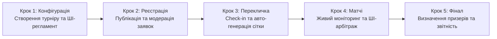

# Інженерна специфікація вимог — Tournado

## 1. Головний шлях користувача (User Journey)

### 1.1. Ключова персона продукту (Primary Persona)

* **Ім'я та вік:** Максим, 21 рік.
* **Роль:** Студентський організатор кіберспортивних змагань, ком'юніті-менеджер університетського ігрового клубу.
* **Контекст:** Має завдання провести відкритий студентський турнір вихідного дня (наприклад, по Counter-Strike 2 на 16 команд) у стислі терміни (до 5 годин) без затримок і скандалів.
* **Головні болі до Tournado:** Ручне ведення сіток в Excel, необхідність писати кожному капітану в Discord, нескінченні затримки через повільний вибір карт у текстових повідомленнях, неявка команд («мертві душі») та затяжні суперечки через сфальсифіковані результати.
* **Обґрунтування вибору персони:** Організатор є головним актором і координатором усієї екосистеми змагань. Без чіткого та зручного інструменту створення турніру та контролю розкладу команди не мають єдиного простору для чесної гри. Автоматизація роботи організатора автоматично створює прозорі та якісні умови для всіх учасників турніру.

---

### 1.2. Лінійний ланцюжок дій за основним успішним сценарієм (Happy Path)

Нижче наведено хронологічний шлях організатора від першого знайомства з платформою до отримання підсумкової звітності. Опис орієнтований на користувацькі дії та бізнес-результати без внутрішнього технічного жаргону.

#### Крок 1: Створення та конфігурація турніру
* **Дія організатора:** Максим авторизується на платформі через Steam або пошту, натискає «Створити турнір», обирає гру (Counter-Strike 2), турнірний формат (Single Elimination на 16 слотів) та вказує дату й час старту. Далі він вводить короткий опис формату у поле помічника (наприклад: *«Студентський кубок, матчі до однієї перемоги, фінал до двох, таймер явки 10 хвилин»*).
* **Реакція системи:** Платформа автоматично підтягує офіційний пул карт, налаштовує розмір команд (5v5), активує таймери для кімнати матчу (30 секунд на бан карти) та генерує структурований проєкт регламенту змагань. Максим переглядає згенерований текст, за потреби коригує правила овертаймів і зберігає налаштування.
* **Результат кроку:** Створено повністю налаштовану публічну подію з індивідуальними правилами, розкладом і готовою сторінкою для збору учасників.

#### Крок 2: Відкриття реєстрації та управління заявками
* **Дія організатора:** Максим копіює коротке запрошувальне посилання на турнір і публікує його в університетському Discord-сервері та Telegram-каналі.
* **Реакція системи:** Капітани команд переходять за посиланням і подають заявки. Система в режимі реального часу перевіряє, щоб кожен гравець у заявленому складі мав заповнений профіль та валідний ігровий ідентифікатор (Steam ID). У разі заповнення всіх 16 основних слотів наступні заявки автоматично спрямовуються до листа очікування.
* **Результат кроку:** Максим бачить прозорий список із 16 повністю укомплектованих команд, перевіряє назви на відповідність цензурі та в один клік фіксує ростери (Roster Lock), унеможливлюючи несанкціоновані заміни гравців під час турніру.

#### Крок 3: Етап переклички (Check-in) та автоматична генерація сітки
* **Дія організатора:** За 30 хвилин до старту Максим відкриває дашборд управління подією та спостерігає за процесом підтвердження явки команд.
* **Реакція системи:** Tournado надсилає сповіщення капітанам і запускає 30-хвилинне вікно Check-in. Дві команди, які не вийшли на зв'язок до закінчення таймера, автоматично відсіюються системою як «мертві душі», а на їхнє місце підтягуються дві перші активні команди з листа очікування. Рівно о запланованій годині система автоматично формує збалансовану турнірну сітку, розподіляє стартові пари та відкриває кімнати матчів першого раунду.
* **Результат кроку:** Турнірна сітка сформована виключно з реальних, присутніх учасників. Максим уникає ручного жеребкування та необхідності екстрено шукати заміну за 5 хвилин до гри.

#### Крок 4: Проведення турніру, моніторинг живих матчів та ШІ-арбітраж
* **Дія організатора:** Максим відкриває живий оглядовий дашборд турніру, на якому відображається статус кожної пари: хто перебуває на стадії підтвердження готовності, хто обирає карти, а хто вже грає.
* **Реакція системи:** Усі матчі першого туру відбуваються автоматично. Капітани входять у кімнату матчу, тиснуть «Готовий», по черзі викреслюють карти за таймером 30 секунд і отримують прямий рядок підключення до гри. Після закінчення гри обидва капітани вносять однаковий рахунок (13:9), і система самостійно пересуває переможця у наступний раунд сітки. 
* **ШІ-арбітраж у випадку суперечки:** В одному з матчів капітани вказали суперечливі результати. Система миттєво позначає матч як «Спірний» та виводить Максиму картку арбітражу: показує завантажений скріншот підсумкового табло гри та висновок ШІ-помічника (*«Розпізнано рахунок 13:10 на користь команди Alpha. Усі 10 нікнеймів збігаються з офіційним ростером. Впевненість 98%»*). Максим натискає кнопку «Затвердити вердикт ШІ», матч успішно закривається, а турнір продовжується без затримок.
* **Результат кроку:** Усі тури змагань проходять синхронно та за графіком. Максим не витрачає час на ручний перегляд чатів і вирішує єдину суперечку за 30 секунд.

#### Крок 5: Завершення турніру та експорт результатів
* **Дія організатора:** Після перемоги однієї з команд у фінальному поєдинку Максим підтверджує завершення турніру на панелі керування.
* **Реакція системи:** Платформа фіксує підсумковий розподіл призових місць (1-ше, 2-ге та 3-тє), автоматично оновлює турнірні досягнення у профілях команд-переможців та генерує готову візуальну картку з результатами для соцмереж.
* **Результат кроку:** Максим за один клік завантажує структурований звіт про результати турніру (у форматі PDF/CSV) для звітності перед керівництвом університету чи спонсорами. Турнір завершено точно за розкладом за 4,5 години замість звичних 8-ми, без скандалів і з позитивними відгуками від студентів.

---

## 2. Карта користувацьких історій (Story Map)

### Крок 1: Створення та налаштування турніру

**Епік 1.1: Базова конфігурація та вибір дисципліни**
- Вибір гри зі списку (CS2, Brawl Stars, Chess.com) з автоматичним застосуванням шаблонів кімнати матчу та розміру команд (5v5, 3v3, 1v1).
- Вибір алгоритму турнірної сітки (Single Elimination або швейцарська система) та встановлення ліміту слотів (8, 16, 32, 64 учасники).
- Налаштування пулу доступних карт (Map Pool) і формату серії ігор (Best of 1 для відбіркових раундів, Best of 3 для фіналу).
- Збереження конфігурації турніру як шаблону для запуску регулярних щотижневих змагань у два кліки.

**Епік 1.2: Розклад і контроль таймінгів**
- Встановлення дати й часу старту турніру, дедлайну реєстрації та часу відкриття обов'язкового підтвердження участі (Check-in).
- Налаштування жорстких таймерів для кімнати матчу: ліміт часу на вихід у готовність (наприклад, 10 хвилин до технічної поразки) та час на один крок бану карти (30 секунд).
- Автоматичний прогноз тривалості всього турніру на основі кількості команд і формату сітки, щоб організатор розумів, чи вкладається подія у відведені 4-5 годин.

**Епік 1.3: Генерація регламенту та оформлення сторінки**
- Автоматична генерація тексту правил і регламенту за коротким текстовим описом організатора на базі валідованого каркаса за допомогою ШІ-асистента.
- Ручне редагування згенерованого регламенту, уточнення правил овертаймів, тай-брейків та технічних пауз.
- Оформлення публічної сторінки турніру: завантаження банера, додавання логотипів спонсорів чи студради, опис призового фонду та прикріплення посилання на трансляцію.

### Крок 2: Відкриття реєстрації та управління заявками команд

**Епік 2.1: Публікація та збір учасників**
- Генерація прямого публічного посилання або короткого інвайт-коду на сторінку турніру для поширення в Discord та Telegram.
- Автоматична публікація анонсу з кнопкою реєстрації у прив'язаний Discord-сервер спільноти через вебхук.
- Додавання кастомних полів до форми реєстрації (наприклад, факультет, навчальна група або курс для внутрішньоуніверситетських змагань).

**Епік 2.2: Модерація заявок та валідація ростерів**
- Перегляд списку зареєстрованих команд у реальному часі з індикацією заповненості ростерів (капітан, основний склад, запасні гравці).
- Автоматична перевірка наявності прив'язаних ігрових акаунтів у всіх заявлених учасників (Steam ID для CS2, Player Tag для Brawl Stars, профіль Chess.com) ще на етапі реєстрації.
- Ручне схвалення або відхилення заявок, а також примусове видалення команд із порушеннями правил чи некоректними назвами до початку ігор.
- Автоматична фіксація складів команд (Roster Lock) перед стартом турніру, щоб унеможливити додавання незареєстрованих сильних гравців під час матчів.

**Епік 2.3: Лист очікування та резервні слоти**
- Автоматичне формування списку очікування (Waitlist) для команд, які подали заявку після заповнення всіх основних слотів.
- Ручне додавання команди організатором або заміна команди, що знялася зі змагань до старту сітки.

### Крок 3: Етап Check-in та автоматична генерація сітки

**Епік 3.1: Відсіювання неактивних команд ("мертвих душ")**
- Автоматичне відкриття вікна Check-in за 30 хвилин до старту турніру з таймером зворотного відліку для всіх зареєстрованих капітанів і соло-гравців.
- Масова розсилка сповіщень учасникам про старт переклички та необхідність підтвердити готовність грати.
- Автоматичне виключення зі списку учасників тих команд, які не натиснули кнопку Check-in до завершення таймера, щоб уникнути порожніх слотів і зриву розкладу.
- Автоматичне підтягування підтверджених команд із листа очікування на місце відсіяних учасників.
- Можливість для організатора вручну поставити відмітку Check-in за команду, якщо капітан попередив про затримку особисто.

**Епік 3.2: Посів (Seeding) та побудова сітки**
- Автоматична генерація турнірної сітки виключно з присутніх команд одразу після закриття вікна Check-in.
- Вибір методу посіву (Seeding): випадкове жеребкування або розведення команд за рейтингом, щоб найсильніші учасники не зустрілися в першому раунді.
- Коректний автоматичний розподіл технічних проходів (Bye-раундів), якщо після відсіювання неактивних заявок кількість команд не дорівнює степеню двійки.
- Попередній перегляд згенерованої сітки з можливістю вручну поміняти команди місцями (Drag-and-Drop) перед офіційним стартом першого туру.

### Крок 4: Проведення турніру (моніторинг живих матчів та вирішення суперечок)

**Епік 4.1: Моніторинг прогресу та автоматизація Match Room**
- Перегляд живого дашборду організатора з актуальними статусами всіх матчів: очікування готовності (Ready Check), стадія бану карт (Pick/Ban), матч триває, очікування рахунку або спір.
- Автоматичне присудження технічної поразки команді або гравцю, який не підтвердив готовність у кімнаті матчу протягом 10 хвилин відведеного часу, без залучення організатора.
- Автоматичне закриття матчу і миттєве просування переможця у наступний раунд сітки, якщо обидва капітани ввели однаковий рахунок або результат надійшов через API Chess.com.
- Візуальне підсвічування затягнутих матчів, які перевищують середній ліміт часу і гальмують запуск наступного туру.

**Епік 4.2: Арбітраж і вирішення суперечок (Disputes) за допомогою ШІ**
- Отримання миттєвого сповіщення у панелі організатора, коли капітани ввели різні рахунки за матч або відкрили спір.
- Перегляд у картці спору завантажених скріншотів табло гри разом зі структурованою підказкою від Vision ШІ (розпізнаний рахунок матчу та відсоток впевненості моделі).
- Автоматична звірка нікнеймів гравців на завантаженому скріншоті із зафіксованим ростером команди в базі даних для виявлення підставних гравців ("рингерів").
- Закриття спірного матчу організатором в один клік на основі рекомендації ШІ або через ручне встановлення фінального рахунку.

**Епік 4.3: Ручне управління сіткою та комунікація**
- Підключення організатора до внутрішнього чату конкретної кімнати матчу для оперативного вирішення питань із капітанами.
- Інструменти ручного втручання (Admin Override): примусовий перезапуск стадії Pick/Ban, заміна посилання на лобі або відкат помилково закритого матчу з перерахунком гілки сітки.
- Відправка глобального оголошення (Broadcast) на екрани всіх активних учасників турніру (наприклад, повідомлення про технічну паузу або зміну розкладу).

### Крок 5: Завершення турніру та експорт результатів

**Епік 5.1: Фіналізація змагань та підрахунок рейтингів**
- Автоматичне переведення турніру в статус "Завершено" після закриття фінального матчу з формуванням підсумкового розподілу призових місць.
- Автоматичний розрахунок додаткових коефіцієнтів (Бухгольц, Бергер) для точного визначення переможців у турнірах за швейцарською системою.
- Автоматичне оновлення статистики в публічних профілях команд і гравців (історія матчів, відсоток перемог, здобуті трофеї).

**Епік 5.2: Візуалізація підсумків і звітність для спонсорів**
- Генерація готової брендованої картинки-інфографіки з призерами та фінальною сіткою в один клік для публікації у соцмережах студради чи ком'юніті.
- Експорт підсумкової таблиці результатів, сітки та списку учасників у форматах CSV/PDF для офіційної звітності перед керівництвом університету, профкомом або спонсорами.
- Формування внутрішньої аналітики для організатора за підсумками події: реальна тривалість турніру, відсоток неявок на етапі Check-in та кількість вирішених диспутів.

---

## 3. Межі скоупу (Scope)

---

## 4. Специфікація історій у роботі (User Stories)

---

## 5. Критерії приймання (Acceptance Criteria)