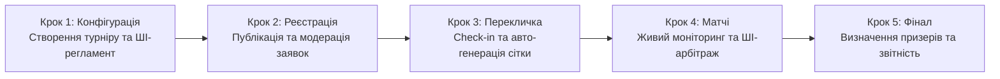

# Інженерна специфікація вимог — Tournado

## 1. Головний шлях користувача (User Journey)

### 1.1. Ключова персона продукту (Primary Persona)

* **Ім'я та вік:** Максим, 21 рік.
* **Роль:** Студентський організатор кіберспортивних змагань, ком'юніті-менеджер університетського ігрового клубу.
* **Контекст:** Має завдання провести відкритий студентський турнір вихідного дня (наприклад, по Counter-Strike 2 на 16 команд) у стислі терміни (до 5 годин) без затримок і скандалів.
* **Головні болі до Tournado:** Ручне ведення сіток в Excel, необхідність писати кожному капітану в Discord, нескінченні затримки через повільний вибір карт у текстових повідомленнях, неявка команд («мертві душі») та затяжні суперечки через сфальсифіковані результати.
* **Обґрунтування вибору персони:** Організатор є головним актором і координатором усієї екосистеми змагань. Без чіткого та зручного інструменту створення турніру та контролю розкладу команди не мають єдиного простору для чесної гри. Автоматизація роботи організатора автоматично створює прозорі та якісні умови для всіх учасників турніру.

---

### 1.2. Лінійний ланцюжок дій за основним успішним сценарієм (Happy Path)

Нижче наведено хронологічний шлях організатора від першого знайомства з платформою до отримання підсумкової звітності. Опис орієнтований на користувацькі дії та бізнес-результати без внутрішнього технічного жаргону.

#### Крок 1: Створення та конфігурація турніру
* **Дія організатора:** Максим авторизується на платформі через Steam або пошту, натискає «Створити турнір», обирає гру (Counter-Strike 2), турнірний формат (Single Elimination на 16 слотів) та вказує дату й час старту. Далі він вводить короткий опис формату у поле помічника (наприклад: *«Студентський кубок, матчі до однієї перемоги, фінал до двох, таймер явки 10 хвилин»*).
* **Реакція системи:** Платформа автоматично підтягує офіційний пул карт, налаштовує розмір команд (5v5), активує таймери для кімнати матчу (30 секунд на бан карти) та генерує структурований проєкт регламенту змагань. Максим переглядає згенерований текст, за потреби коригує правила овертаймів і зберігає налаштування.
* **Результат кроку:** Створено повністю налаштовану публічну подію з індивідуальними правилами, розкладом і готовою сторінкою для збору учасників.

#### Крок 2: Відкриття реєстрації та управління заявками
* **Дія організатора:** Максим копіює коротке запрошувальне посилання на турнір і публікує його в університетському Discord-сервері та Telegram-каналі.
* **Реакція системи:** Капітани команд переходять за посиланням і подають заявки. Система в режимі реального часу перевіряє, щоб кожен гравець у заявленому складі мав заповнений профіль та валідний ігровий ідентифікатор (Steam ID). У разі заповнення всіх 16 основних слотів наступні заявки автоматично спрямовуються до листа очікування.
* **Результат кроку:** Максим бачить прозорий список із 16 повністю укомплектованих команд, перевіряє назви на відповідність цензурі та в один клік фіксує ростери (Roster Lock), унеможливлюючи несанкціоновані заміни гравців під час турніру.

#### Крок 3: Етап переклички (Check-in) та автоматична генерація сітки
* **Дія організатора:** За 30 хвилин до старту Максим відкриває дашборд управління подією та спостерігає за процесом підтвердження явки команд.
* **Реакція системи:** Tournado надсилає сповіщення капітанам і запускає 30-хвилинне вікно Check-in. Дві команди, які не вийшли на зв'язок до закінчення таймера, автоматично відсіюються системою як «мертві душі», а на їхнє місце підтягуються дві перші активні команди з листа очікування. Рівно о запланованій годині система автоматично формує збалансовану турнірну сітку, розподіляє стартові пари та відкриває кімнати матчів першого раунду.
* **Результат кроку:** Турнірна сітка сформована виключно з реальних, присутніх учасників. Максим уникає ручного жеребкування та необхідності екстрено шукати заміну за 5 хвилин до гри.

#### Крок 4: Проведення турніру, моніторинг живих матчів та ШІ-арбітраж
* **Дія організатора:** Максим відкриває живий оглядовий дашборд турніру, на якому відображається статус кожної пари: хто перебуває на стадії підтвердження готовності, хто обирає карти, а хто вже грає.
* **Реакція системи:** Усі матчі першого туру відбуваються автоматично. Капітани входять у кімнату матчу, тиснуть «Готовий», по черзі викреслюють карти за таймером 30 секунд і отримують прямий рядок підключення до гри. Після закінчення гри обидва капітани вносять однаковий рахунок (13:9), і система самостійно пересуває переможця у наступний раунд сітки. 
* **ШІ-арбітраж у випадку суперечки:** В одному з матчів капітани вказали суперечливі результати. Система миттєво позначає матч як «Спірний» та виводить Максиму картку арбітражу: показує завантажений скріншот підсумкового табло гри та висновок ШІ-помічника (*«Розпізнано рахунок 13:10 на користь команди Alpha. Усі 10 нікнеймів збігаються з офіційним ростером. Впевненість 98%»*). Максим натискає кнопку «Затвердити вердикт ШІ», матч успішно закривається, а турнір продовжується без затримок.
* **Результат кроку:** Усі тури змагань проходять синхронно та за графіком. Максим не витрачає час на ручний перегляд чатів і вирішує єдину суперечку за 30 секунд.

#### Крок 5: Завершення турніру та експорт результатів
* **Дія організатора:** Після перемоги однієї з команд у фінальному поєдинку Максим підтверджує завершення турніру на панелі керування.
* **Реакція системи:** Платформа фіксує підсумковий розподіл призових місць (1-ше, 2-ге та 3-тє), автоматично оновлює турнірні досягнення у профілях команд-переможців та генерує готову візуальну картку з результатами для соцмереж.
* **Результат кроку:** Максим за один клік завантажує структурований звіт про результати турніру (у форматі PDF/CSV) для звітності перед керівництвом університету чи спонсорами. Турнір завершено точно за розкладом за 4,5 години замість звичних 8-ми, без скандалів і з позитивними відгуками від студентів.

---

## 2. Карта користувацьких історій (Story Map)

### Крок 1: Створення та налаштування турніру

**Епік 1.1: Базова конфігурація та вибір дисципліни**
- Вибір гри зі списку (CS2, Brawl Stars, Chess.com) з автоматичним застосуванням шаблонів кімнати матчу та розміру команд (5v5, 3v3, 1v1).
- Вибір алгоритму турнірної сітки (Single Elimination або швейцарська система) та встановлення ліміту слотів (8, 16, 32, 64 учасники).
- Налаштування пулу доступних карт (Map Pool) і формату серії ігор (Best of 1 для відбіркових раундів, Best of 3 для фіналу).
- Збереження конфігурації турніру як шаблону для запуску регулярних щотижневих змагань у два кліки.

**Епік 1.2: Розклад і контроль таймінгів**
- Встановлення дати й часу старту турніру, дедлайну реєстрації та часу відкриття обов'язкового підтвердження участі (Check-in).
- Налаштування жорстких таймерів для кімнати матчу: ліміт часу на вихід у готовність (наприклад, 10 хвилин до технічної поразки) та час на один крок бану карти (30 секунд).
- Автоматичний прогноз тривалості всього турніру на основі кількості команд і формату сітки, щоб організатор розумів, чи вкладається подія у відведені 4-5 годин.

**Епік 1.3: Генерація регламенту та оформлення сторінки**
- Автоматична генерація тексту правил і регламенту за коротким текстовим описом організатора на базі валідованого каркаса за допомогою ШІ-асистента.
- Ручне редагування згенерованого регламенту, уточнення правил овертаймів, тай-брейків та технічних пауз.
- Оформлення публічної сторінки турніру: завантаження банера, додавання логотипів спонсорів чи студради, опис призового фонду та прикріплення посилання на трансляцію.

### Крок 2: Відкриття реєстрації та управління заявками команд

**Епік 2.1: Публікація та збір учасників**
- Генерація прямого публічного посилання або короткого інвайт-коду на сторінку турніру для поширення в Discord та Telegram.
- Автоматична публікація анонсу з кнопкою реєстрації у прив'язаний Discord-сервер спільноти через вебхук.
- Додавання кастомних полів до форми реєстрації (наприклад, факультет, навчальна група або курс для внутрішньоуніверситетських змагань).

**Епік 2.2: Модерація заявок та валідація ростерів**
- Перегляд списку зареєстрованих команд у реальному часі з індикацією заповненості ростерів (капітан, основний склад, запасні гравці).
- Автоматична перевірка наявності прив'язаних ігрових акаунтів у всіх заявлених учасників (Steam ID для CS2, Player Tag для Brawl Stars, профіль Chess.com) ще на етапі реєстрації.
- Ручне схвалення або відхилення заявок, а також примусове видалення команд із порушеннями правил чи некоректними назвами до початку ігор.
- Автоматична фіксація складів команд (Roster Lock) перед стартом турніру, щоб унеможливити додавання незареєстрованих сильних гравців під час матчів.

**Епік 2.3: Лист очікування та резервні слоти**
- Автоматичне формування списку очікування (Waitlist) для команд, які подали заявку після заповнення всіх основних слотів.
- Ручне додавання команди організатором або заміна команди, що знялася зі змагань до старту сітки.

### Крок 3: Етап Check-in та автоматична генерація сітки

**Епік 3.1: Відсіювання неактивних команд ("мертвих душ")**
- Автоматичне відкриття вікна Check-in за 30 хвилин до старту турніру з таймером зворотного відліку для всіх зареєстрованих капітанів і соло-гравців.
- Масова розсилка сповіщень учасникам про старт переклички та необхідність підтвердити готовність грати.
- Автоматичне виключення зі списку учасників тих команд, які не натиснули кнопку Check-in до завершення таймера, щоб уникнути порожніх слотів і зриву розкладу.
- Автоматичне підтягування підтверджених команд із листа очікування на місце відсіяних учасників.
- Можливість для організатора вручну поставити відмітку Check-in за команду, якщо капітан попередив про затримку особисто.

**Епік 3.2: Посів (Seeding) та побудова сітки**
- Автоматична генерація турнірної сітки виключно з присутніх команд одразу після закриття вікна Check-in.
- Вибір методу посіву (Seeding): випадкове жеребкування або розведення команд за рейтингом, щоб найсильніші учасники не зустрілися в першому раунді.
- Коректний автоматичний розподіл технічних проходів (Bye-раундів), якщо після відсіювання неактивних заявок кількість команд не дорівнює степеню двійки.
- Попередній перегляд згенерованої сітки з можливістю вручну поміняти команди місцями (Drag-and-Drop) перед офіційним стартом першого туру.

### Крок 4: Проведення турніру (моніторинг живих матчів та вирішення суперечок)

**Епік 4.1: Моніторинг прогресу та автоматизація Match Room**
- Перегляд живого дашборду організатора з актуальними статусами всіх матчів: очікування готовності (Ready Check), стадія бану карт (Pick/Ban), матч триває, очікування рахунку або спір.
- Автоматичне присудження технічної поразки команді або гравцю, який не підтвердив готовність у кімнаті матчу протягом 10 хвилин відведеного часу, без залучення організатора.
- Автоматичне закриття матчу і миттєве просування переможця у наступний раунд сітки, якщо обидва капітани ввели однаковий рахунок або результат надійшов через API Chess.com.
- Візуальне підсвічування затягнутих матчів, які перевищують середній ліміт часу і гальмують запуск наступного туру.

**Епік 4.2: Арбітраж і вирішення суперечок (Disputes) за допомогою ШІ**
- Отримання миттєвого сповіщення у панелі організатора, коли капітани ввели різні рахунки за матч або відкрили спір.
- Перегляд у картці спору завантажених скріншотів табло гри разом зі структурованою підказкою від Vision ШІ (розпізнаний рахунок матчу та відсоток впевненості моделі).
- Автоматична звірка нікнеймів гравців на завантаженому скріншоті із зафіксованим ростером команди в базі даних для виявлення підставних гравців ("рингерів").
- Закриття спірного матчу організатором в один клік на основі рекомендації ШІ або через ручне встановлення фінального рахунку.

**Епік 4.3: Ручне управління сіткою та комунікація**
- Підключення організатора до внутрішнього чату конкретної кімнати матчу для оперативного вирішення питань із капітанами.
- Інструменти ручного втручання (Admin Override): примусовий перезапуск стадії Pick/Ban, заміна посилання на лобі або відкат помилково закритого матчу з перерахунком гілки сітки.
- Відправка глобального оголошення (Broadcast) на екрани всіх активних учасників турніру (наприклад, повідомлення про технічну паузу або зміну розкладу).

### Крок 5: Завершення турніру та експорт результатів

**Епік 5.1: Фіналізація змагань та підрахунок рейтингів**
- Автоматичне переведення турніру в статус "Завершено" після закриття фінального матчу з формуванням підсумкового розподілу призових місць.
- Автоматичний розрахунок додаткових коефіцієнтів (Бухгольц, Бергер) для точного визначення переможців у турнірах за швейцарською системою.
- Автоматичне оновлення статистики в публічних профілях команд і гравців (історія матчів, відсоток перемог, здобуті трофеї).

**Епік 5.2: Візуалізація підсумків і звітність для спонсорів**
- Генерація готової брендованої картинки-інфографіки з призерами та фінальною сіткою в один клік для публікації у соцмережах студради чи ком'юніті.
- Експорт підсумкової таблиці результатів, сітки та списку учасників у форматах CSV/PDF для офіційної звітності перед керівництвом університету, профкомом або спонсорами.
- Формування внутрішньої аналітики для організатора за підсумками події: реальна тривалість турніру, відсоток неявок на етапі Check-in та кількість вирішених диспутів.

---

## 3. Межі скоупу (Scope)

### 3.1. Принцип відсікання

MVP - це **тонкий наскрізний зріз** через усі 5 кроків шляху: Максим має пройти від створення турніру до підсумкової таблиці, використовуючи лише історії з In Scope. Кожну історію з карти (розділ 2) ми оцінили за MoSCoW:

- **Must** - без неї шлях обривається або не закривається головний біль персони («мертві душі», ручна сітка, ручні рахунки, суперечки, підставні гравці). Лише Must входять у **In Scope (MVP)**.
- **Should / Could / Won't** - корисні, але не критичні історії. Вони йдуть в **Out of Scope (Post-MVP)** із поясненням, чому саме.

Якщо в історії поєднано просту базову частину і дорогу розширену, ми розділили її: базова частина йде в MVP, розширена - у Post-MVP (позначено як `а` / `б`).

Нумерація: `Крок.Епік.Номер` - відповідає порядку історій у розділі 2.

### 3.2. Карта історій з лінією відсікання

#### Крок 1: Створення та налаштування турніру

| № | Історія | MoSCoW | Рішення | Обґрунтування |
| :--- | :--- | :---: | :---: | :--- |
| 1.1.1 | Вибір гри (CS2, Brawl Stars, Chess.com) з автоматичним шаблоном матчу, розміром команд і стандартним пулом карт | Must | ✅ MVP | Без вибору дисципліни турнір неможливо створити; стандартний пул карт підставляється автоматично |
| 1.1.2а | Формат Single Elimination і ліміт слотів (8 / 16 / 32) | Must | ✅ MVP | Найпростіший формат, достатній для повного шляху |
| 1.1.2б | Швейцарська система | Should | ⏳ Post-MVP | Окремий складний алгоритм пар і тай-брейків; Single Elimination закриває сценарій ключової персони |
| 1.1.3 | Редагування пулу карт і формат Best of 3 для фіналу | Could | ⏳ Post-MVP | Серія з кількох карт ускладнює кімнату матчу; у MVP усі матчі Best of 1 зі стандартним пулом |
| 1.1.4 | Збереження турніру як шаблону | Could | ⏳ Post-MVP | Цінність лише для регулярних турнірів; обхід - створити новий за 2 хвилини |
| 1.2.1 | Дата й час старту, дедлайн реєстрації, час відкриття Check-in | Must | ✅ MVP | Без розкладу неможливий автоматичний Check-in - головний засіб проти «мертвих душ» |
| 1.2.2 | Налаштування значень таймерів кімнати матчу | Could | ⏳ Post-MVP | У MVP таймери працюють із фіксованими значеннями (10 хв на готовність, 30 с на бан); змінювати їх не обов'язково |
| 1.2.3 | Прогноз тривалості турніру | Could | ⏳ Post-MVP | Не на критичному шляху; організатор оцінює тривалість сам |
| 1.3.1 | ШІ-генерація регламенту за описом | Should | ⏳ Post-MVP | Ризик галюцинацій у критичних правилах (висновок практики 2); ресурс AI-напряму в MVP зосереджено на суперечках |
| 1.3.2 | Ручне редагування регламенту | Could | ⏳ Post-MVP | Залежить від 1.3.1; у MVP правила вписуються в поле «Опис турніру» під час створення (1.1.1) |
| 1.3.3 | Оформлення сторінки: банер, спонсори, призовий фонд, трансляція | Could | ⏳ Post-MVP | Косметика, не закриває болю; базова сторінка з назвою, грою, датою, описом і учасниками входить у 2.1.1 |

#### Крок 2: Відкриття реєстрації та управління заявками

| № | Історія | MoSCoW | Рішення | Обґрунтування |
| :--- | :--- | :---: | :---: | :--- |
| 2.1.1 | Публічне посилання на сторінку турніру | Must | ✅ MVP | Єдиний спосіб зібрати учасників; поширюється вручну в Discord / Telegram |
| 2.1.2 | Автоанонс у Discord через вебхук | Could | ⏳ Post-MVP | Зовнішня інтеграція; обхід - скопіювати посилання з 2.1.1 |
| 2.1.3 | Кастомні поля форми реєстрації | Won't | ⏳ Post-MVP | Потрібні лише внутрішньоуніверситетським турнірам; додає конструктор форм |
| 2.2.1 | Список зареєстрованих команд із заповненістю ростерів | Must | ✅ MVP | Організатор має бачити, хто реально бере участь |
| 2.2.2а | Перевірка, що в кожного гравця вказано ігровий ідентифікатор потрібної гри (Steam ID / Player Tag / нік Chess.com) | Must | ✅ MVP | Без ідентифікаторів не працює ні звірка нікнеймів (4.2.3), ні автоімпорт шахових результатів (4.1.3б) |
| 2.2.2б | Перевірка існування акаунтів через API ігор | Should | ⏳ Post-MVP | API Brawl Stars вимагає ключа з прив'язкою до IP; перевірку замінює звірка нікнеймів у суперечках |
| 2.2.3а | Видалення команди організатором до старту | Must | ✅ MVP | Мінімальна модерація (порушення, образливі назви) |
| 2.2.3б | Режим ручного схвалення кожної заявки | Could | ⏳ Post-MVP | Для відкритого турніру достатньо видалення після реєстрації |
| 2.2.4 | Фіксація складів (Roster Lock) перед стартом | Must | ✅ MVP | Закриває біль підставних гравців; база для звірки нікнеймів |
| 2.3.1 | Лист очікування | Should | ⏳ Post-MVP | Без нього сітка все одно будується з присутніх команд, а порожні місця закриваються технічними проходами (3.2.3) |
| 2.3.2 | Ручне додавання або заміна команди | Could | ⏳ Post-MVP | Рідкісний випадок; обхід - капітан реєструє команду сам до дедлайну |

#### Крок 3: Check-in та автоматична генерація сітки

| № | Історія | MoSCoW | Рішення | Обґрунтування |
| :--- | :--- | :---: | :---: | :--- |
| 3.1.1 | Автоматичне відкриття вікна Check-in із таймером | Must | ✅ MVP | Ядро боротьби з «мертвими душами» |
| 3.1.2 | Масова розсилка сповіщень учасникам | Should | ⏳ Post-MVP | Потребує інтеграції з поштою / Telegram / Discord; у MVP статус Check-in видно на сторінці турніру |
| 3.1.3 | Автоматичне виключення команд без Check-in | Must | ✅ MVP | Головний біль персони - сітка не ламається через неявки |
| 3.1.4 | Підтягування команд із листа очікування | Should | ⏳ Post-MVP | Залежить від відкладеної 2.3.1 |
| 3.1.5 | Ручна відмітка Check-in організатором | Could | ⏳ Post-MVP | Обхід - капітан підтверджує участь сам із телефона |
| 3.2.1 | Автоматична генерація сітки з присутніх команд | Must | ✅ MVP | Головний біль - ручне креслення сітки в Excel |
| 3.2.2а | Випадкове жеребкування (посів) | Must | ✅ MVP | Найпростіший чесний посів; виконується в межах 3.2.1 |
| 3.2.2б | Посів за рейтингом | Could | ⏳ Post-MVP | На старті платформи ще немає рейтингу команд |
| 3.2.3 | Технічні проходи (Bye), якщо кількість команд не є степенем двійки | Must | ✅ MVP | Після відсіювання неявок це майже гарантовано станеться; без цього сітка не будується |
| 3.2.4 | Попередній перегляд сітки з перетягуванням команд | Could | ⏳ Post-MVP | Ручне втручання суперечить ідеї автоматизації; випадкового жеребкування достатньо |

#### Крок 4: Проведення турніру та вирішення суперечок

| № | Історія | MoSCoW | Рішення | Обґрунтування |
| :--- | :--- | :---: | :---: | :--- |
| 4.1.1 | Живий дашборд організатора зі статусами всіх матчів | Must | ✅ MVP | Головний робочий екран Максима під час турніру |
| 4.1.2 | Автоматична технічна поразка за неготовність протягом 10 хвилин | Must | ✅ MVP | Закриває затягування матчів без участі організатора |
| 4.1.3а | Автозакриття матчу і просування переможця, якщо обидва капітани ввели однаковий рахунок (CS2, Brawl Stars) | Must | ✅ MVP | Головний біль - ручне перенесення рахунків |
| 4.1.3б | Автоматичне підтягування результату партії з відкритого архіву Chess.com | Must | ✅ MVP | Відкритий API лише для читання, низький ризик; закриває сценарій шахів без ручного введення |
| 4.1.4 | Підсвічування затягнутих матчів | Could | ⏳ Post-MVP | Таймер готовності (4.1.2) вже закриває основну причину затримок |
| 4.2.1 | Сповіщення організатора про спірний матч | Must | ✅ MVP | Спірний матч не має загубитися; у MVP це статус «Спір» і лічильник на дашборді 4.1.1 |
| 4.2.2 | Картка спору зі скріншотом і підказкою ШІ (розпізнаний рахунок і впевненість) | Must | ✅ MVP | Ключова ШІ-функція продукту; ШІ лише підказує, рішення за людиною (висновок практики 2) |
| 4.2.3 | Звірка нікнеймів зі скріншота з ростером | Must | ✅ MVP | Закриває біль підставних гравців; виконується тим самим зверненням до ШІ, що й 4.2.2 |
| 4.2.4 | Закриття спору в один клік (вердикт ШІ або ручний рахунок) | Must | ✅ MVP | Без цього спірний матч блокує сітку |
| 4.3.1 | Чат організатора в кімнаті матчу | Should | ⏳ Post-MVP | Обхід - Discord, яким учасники вже користуються |
| 4.3.2 | Ручне втручання: перезапуск Pick/Ban, заміна лобі, відкат матчу з перерахунком гілки | Should | ⏳ Post-MVP | Відкат із перерахунком сітки - складна логіка; у MVP помилковий рахунок виправляється через спір (4.2.4) до просування |
| 4.3.3 | Глобальне оголошення для всіх учасників | Could | ⏳ Post-MVP | Обхід - оголошення в Discord-сервері турніру |

#### Крок 5: Завершення турніру та експорт результатів

| № | Історія | MoSCoW | Рішення | Обґрунтування |
| :--- | :--- | :---: | :---: | :--- |
| 5.1.1 | Статус «Завершено» і розподіл призових місць після фіналу | Must | ✅ MVP | Логічне завершення шляху |
| 5.1.2 | Коефіцієнти Бухгольца й Бергера | Should | ⏳ Post-MVP | Потрібні лише для швейцарської системи (1.1.2б), яку відкладено |
| 5.1.3 | Оновлення статистики в профілях команд і гравців | Could | ⏳ Post-MVP | Цінність проявляється лише після серії турнірів |
| 5.2.1 | Інфографіка з призерами для соцмереж | Could | ⏳ Post-MVP | Обхід - скріншот фінальної сітки |
| 5.2.2а | Експорт результатів і учасників у CSV | Must | ✅ MVP | Мета персони - звіт для профкому чи спонсорів; CSV відкривається в Excel без додаткових бібліотек |
| 5.2.2б | Експорт у PDF | Could | ⏳ Post-MVP | Обхід - зберегти CSV як PDF з Excel |
| 5.2.3 | Аналітика організатора (тривалість, відсоток неявок, кількість суперечок) | Could | ⏳ Post-MVP | Не на критичному шляху першого турніру |

### 3.3. Опорні історії учасників (In Scope)

Карта в розділі 2 описує лише дії організатора. Щоб його шлях реально пройшов, у MVP обов'язково потрібні мінімальні дії капітанів і гравців:

| № | Хто | Історія | Чому без неї шлях обривається |
| :--- | :--- | :--- | :--- |
| У.1 | Будь-який користувач | Вхід на платформу через Steam або пошту | Без акаунта не можна ні створити турнір, ні зареєструватися |
| У.2 | Капітан | Створення команди та запрошення тімейтів за посиланням | Організатору нема кого приймати на турнір (крок 2) |
| У.3 | Капітан / соло-гравець | Реєстрація команди або себе на турнір за посиланням | Без заявок порожній крок 2 |
| У.4 | Капітан / соло-гравець | Підтвердження участі (Check-in) | Без нього всі команди будуть виключені (3.1.3) |
| У.5 | Учасник | Перегляд турнірної сітки | Учасники мають знати свого суперника і час матчу |
| У.6 | Капітан | Підтвердження готовності (Ready Check) у кімнаті матчу | На цьому базується автоматична технічна поразка (4.1.2) |
| У.7 | Капітан | Почерговий бан карт із таймером (CS2, Brawl Stars) | Замінює хаотичний вибір карт у чаті - ключова відмінність від Excel |
| У.8 | Капітан / гравець | Отримання даних для входу в гру: рядок підключення до сервера CS2 (вказує організатор), код дружньої кімнати Brawl Stars (вводить капітан), посилання на виклик Chess.com | Без цього матч фізично не почнеться |
| У.9 | Капітан | Введення рахунку після матчу (CS2, Brawl Stars) | Джерело даних для автозакриття (4.1.3а) і спорів (4.2.1) |
| У.10 | Капітан | Завантаження скріншота табло при суперечці | Вхідні дані для ШІ-підказки (4.2.2, 4.2.3) |

### 3.4. Підсумок скоупу

| | Кількість |
| :--- | :---: |
| Історій організатора в MVP | 23 |
| Опорних історій учасників у MVP | 10 |
| **Разом In Scope (MVP)** | **33** |
| Відкладено в Out of Scope (Post-MVP) | 28 |

**Розподіл MVP за ролями команди** (перевірка, що жодна роль не перевантажена):

| Роль | Історії MVP |
| :--- | :--- |
| Core Platform & Auth (Артем) | У.1, У.2, У.3, 2.2.2а, 2.2.3а, 2.2.4, 5.2.2а |
| Tournament Engine (Євгеній) | 1.1.2а, 1.2.1, 3.1.1, 3.1.3, 3.2.1, 3.2.2а, 3.2.3, 4.1.3а (просування), 5.1.1 |
| Game Integrations & Match Flow (Денис) | 1.1.1, У.4, У.6, У.7, У.8, У.9, 4.1.2, 4.1.3б |
| AI & Automation (Іван) | У.10, 4.2.2, 4.2.3, 4.2.4 (дані для вердикту) |
| Frontend (Андрій) | 2.1.1, 2.2.1, У.5, 4.1.1, 4.2.1, екрани кімнати матчу та картки спору |

Історії Tournament Engine невеликі й тісно пов'язані (сітка Single Elimination), а частка AI-напряму менша за кількістю, але найризиковіша технічно (якість розпізнавання скріншотів, підбір промптів для трьох різних табло).

### 3.5. Демо-сценарій MVP і відмінності від повного Happy Path

**Що покажемо наживо:** Максим входить через Steam, створює турнір CS2 на 8 слотів і ділиться посиланням. Капітани реєструють команди, одна з них не проходить Check-in і автоматично вибуває. Система будує сітку з технічним проходом. У кімнатах матчів капітани тиснуть «Готовий», банять карти й отримують рядок підключення. Один матч закривається автоматично за однаковим рахунком, в іншому виникає спір: Максим бачить скріншот, підказку ШІ з рахунком і перевіркою нікнеймів і закриває спір в один клік. Після фіналу турнір отримує статус «Завершено», а Максим вивантажує CSV. Окремо показуємо шаховий матч, результат якого підтягується з Chess.com без участі капітанів.

**Що з повного Happy Path (розділ 1) свідомо не входить у MVP:**
- ШІ-генерація регламенту (крок 1) - замінено полем «Опис турніру».
- Лист очікування й підтягування резервних команд (кроки 2-3) - замінено технічними проходами в сітці.
- Сповіщення капітанам про Check-in (крок 3) - статус видно на сторінці турніру.
- Інфографіка для соцмереж, PDF-звіт і оновлення профілів (крок 5) - замінено експортом у CSV.

---

## 4. Специфікація історій у роботі (User Stories)

---

## 5. Критерії приймання (Acceptance Criteria)